<div align="center">


# Polyth

### One workspace for every coding agent. And everyone you build with.

Claude Code, Codex, OpenCode, Pi, Antigravity, Cursor, DeepSeek and GitHub Copilot on
one permanent history. Switch agents mid-conversation, share one server with your
team, approve risky calls from your phone, and reshape every part of the interface.

**[Download](https://polyth.app/download/)** · [Quick start](#quick-start) · [Features](#and-everything-around-the-code) · [Run it your way](#run-it-your-way) · [Docs](#documentation) · [polyth.app](https://polyth.app) · [Patreon](https://www.patreon.com/c/polyth)

<sub>Free and open source · macOS, Windows, Linux and Android · or your own server</sub>

</div>

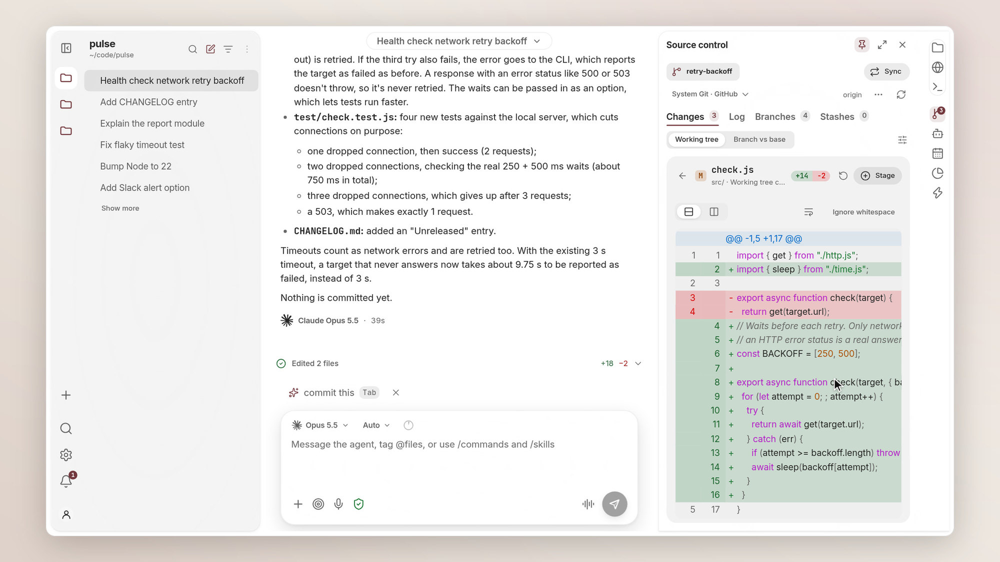

<div align="center">

**8** coding agents, one history · **75+** packages to switch, swap or fork · **12** interface languages · **0** ports to open for your phone

</div>

## Four ideas, built in from day one

- **One history, any agent.** Switch agents mid-conversation and keep every word.
- **Safe by default.** Risky calls wait for a person, on whichever device is closest.
- **Built for a team.** One server, everyone on it: personal accounts, private chats,
  sharing, roles and limits.
- **Yours to reshape.** Every feature is a package. Switch it off, install a new one
  from a link, or have an agent build it.

## Switch agents mid-conversation. Keep every word.

<table>
  <tr>
    <td width="50%">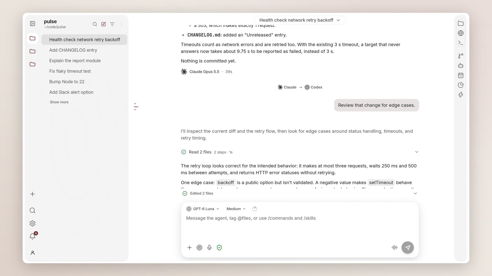</td>
    <td width="50%">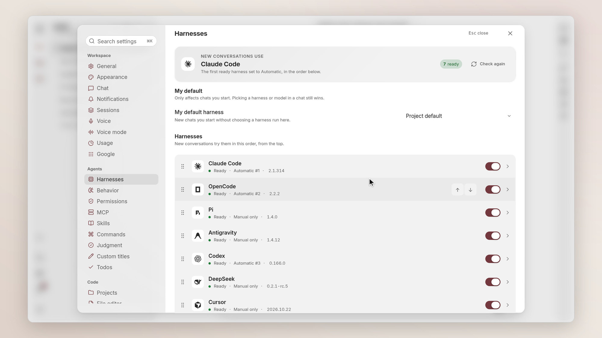</td>
  </tr>
  <tr>
    <td><em>Claude Code wrote it, Codex reviews it. Same chat, same history.</em></td>
    <td><em>Bring the agents you already use. Polyth reuses their sign-in.</em></td>
  </tr>
</table>

Every chat is a permanent, append-only record that Polyth keeps. The agent CLI
underneath (a *harness*) only runs the current turn, so you can change it at any time
and nothing is silently rewritten.

- **Switch mid-conversation.** Start on Claude Code, continue on Codex, finish on a
  local model through OpenCode or Pi.
- **Fork, rewind, redo.** Branch from any message or step back without losing the
  original. Queue messages, steer a running turn, or ask a quick side question
  without interrupting it.
- **Bring your history.** Import Claude Code, Codex, OpenCode, Pi, Cursor and Copilot
  conversations and continue them on any agent. Paste a ChatGPT share link and the
  agent reads it.
- **Delegate across agents.** An agent starts helpers on other agents, each in your
  checkout or its own Git worktree, and merges their work back.
- **Rich answers.** Markdown, Mermaid, math, sortable tables, charts, forms and option
  cards, rendered inline.

Supported harnesses: Claude Code (Agent SDK), Codex (App Server), OpenCode, Pi,
Antigravity, Cursor, DeepSeek (`dsh`) and GitHub Copilot CLI, with Command Code in
beta. New chats start on the first ready agent in your order, or on the one you pick
for a chat or a project.

## Agents do the work. People make the risky calls.

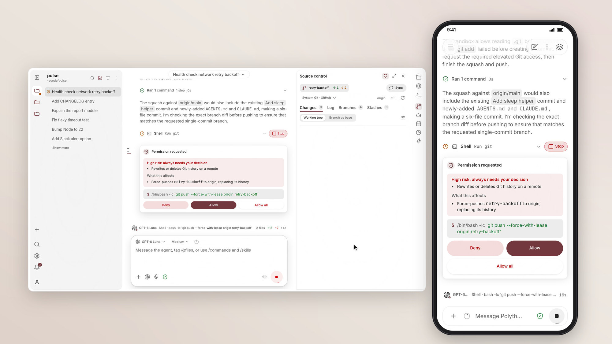

A permission engine that refuses when in doubt sits between every agent and your
machine. Pick a level for the Space and the project, override it per chat; helper
agents inherit their parent's level.

| Level | What happens |
|---|---|
| **Ask** | Every request waits for an answer: once, for this chat, or always for the project. |
| **Auto-approve** | Routine work flows. Deletes, force-pushes, sudo, credential access, deploys and writes outside the project still wait for a person. |
| **Full access** | Everything not blocked by an explicit deny rule runs. Opt-in, confirmed, and best kept for throwaway environments. |

- **Deny rules always win**, at every level including Full access.
- **No self-promotion.** An agent may turn its autonomy down, never up. Command-line
  and automation tokens can run agents but never answer a permission request.
- **Secrets stay sealed.** Credential Vault gives agents a handle, never the value; the
  server fills it into one command and redacts it from the output.
- **Default-deny devices.** A new phone can do nothing until you allow it, and access
  can be revoked at any time.
- **No open ports.** Phones connect through Polyth Link, an authenticated, encrypted
  QUIC tunnel.

Honest about the limits: the risk check reads what the agent says it is about to do.
It is a tripwire, not a sandbox, and an agent's own tools run with the permissions of
the account that runs Polyth. For hard isolation, run Polyth in a container or VM that
holds only what the agents should reach. [SECURITY.md](SECURITY.md) and
[polyth.app/security](https://polyth.app/security/) describe the full model.

## One server for everyone you build with

Not a single-user remote with a shared password. Each person signs in as themselves,
chats stay private until they are shared, and the owner decides what every account
may do.

- **Spaces with real boundaries.** A Space owns its projects, chats, files, worktrees,
  knowledge, secrets and integrations. Keep home, work and client projects apart; the
  server checks membership on every request. Roles: Owner, Admin, Member, Viewer.
- **Private by default.** New chats are private. Share one with specific people or the
  whole Space, to read along or to work in it together. Admins cannot open private
  chats.
- **Who said what.** Every message shows its author, and the agent works with the
  sender's own accounts.
- **Talk to people too.** @-mentions and notifications; turn any thread into an agent
  session in one step.
- **Limits per account.** Allowed projects and assistants, messages or new chats per
  day, with today's use always visible.
- **Protected mode.** No composer shell, no Auto-approve: a person answers every
  request.

## Not a settings page. A set of parts.

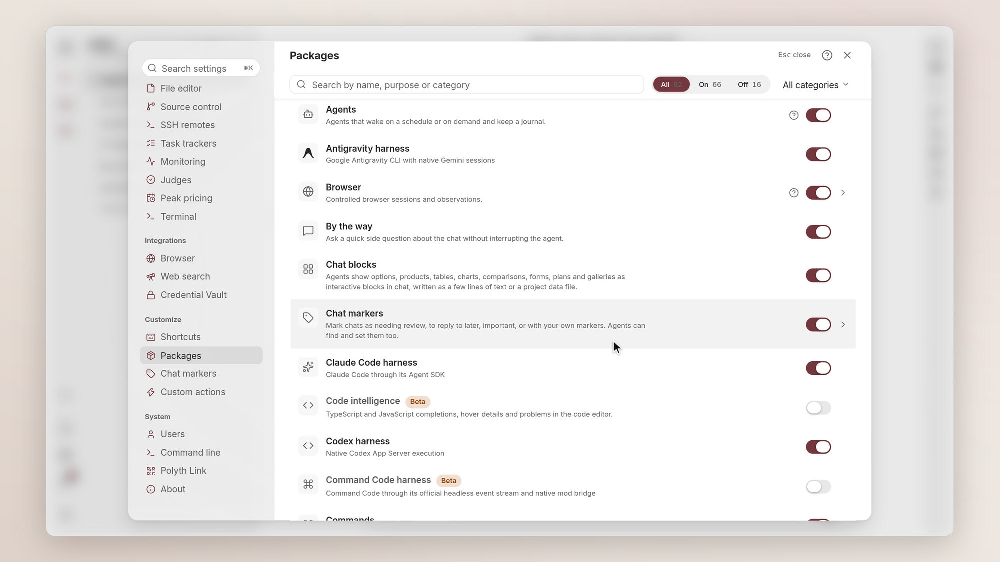

Polyth is a small host with 75+ packages around it. Chat, source control, the
terminal, the browser, voice, resident agents, integrations, even support for each
coding agent: each brings its own server code, interface and styles, and plugs into
typed slots.

- **Turn off what you don't use.** Settings → Packages switches packages per Space.
  Previews ship off and are marked Beta.
- **Remove it cleanly.** A package is one folder. The host never names it, so removing
  it leaves nothing behind.
- **Install from a link.** A GitHub, GitLab or Codeberg repository, a branch or tag, a
  `.zip` URL, or a folder on your computer. Review the access it asks for and grant it
  for this Space only.
- **Updates you approve.** Let packages update themselves; an update that asks for new
  access waits for you. Or install as your own fork and keep your edits on top.
- **Built by an agent.** Polyth is written to be changed by coding agents: shared
  rules, skills for every area, a package SDK and typed UI slots. Describe a feature in
  a chat on Polyth's own code and get it as a package.

Appearance is a stack of independent choices: platform style (macOS Liquid Glass,
Windows 11 Fluent, macOS Big Sur or Polyth Classic), whole-window looks,
light/dark/system, any accent and your own JSON theme, workspace backgrounds and glass,
fonts, density, widget areas, rails and an optional status bar, an editable keymap
with a command palette, per-project or shared layouts, and twelve interface languages.

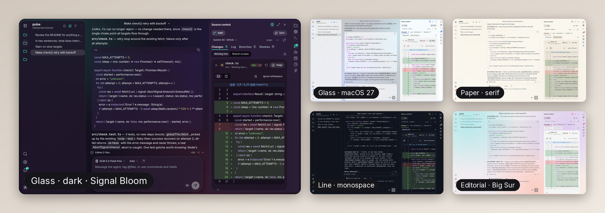

## And everything around the code

<table>
  <tr>
    <td width="50%">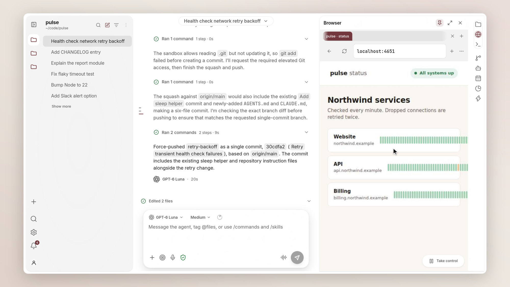</td>
    <td width="50%">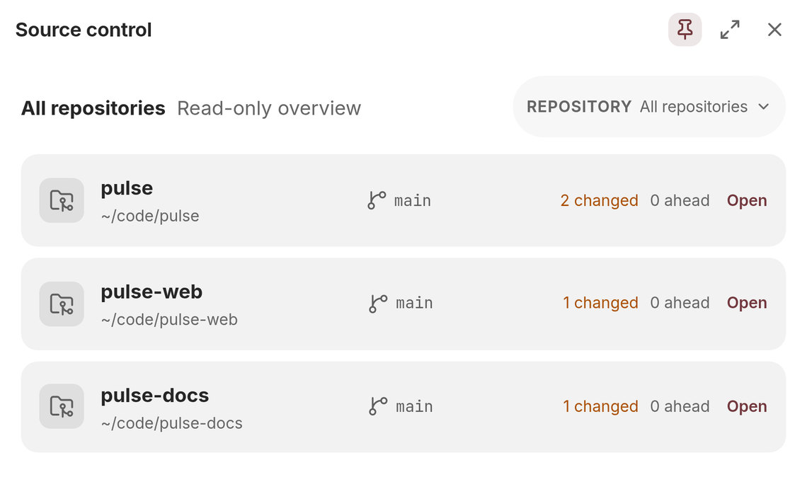</td>
  </tr>
  <tr>
    <td><em>A browser you share: the agent drives it, you take over at any moment.</em></td>
    <td><em>One project, many repositories, each with its own branch and changes.</em></td>
  </tr>
  <tr>
    <td>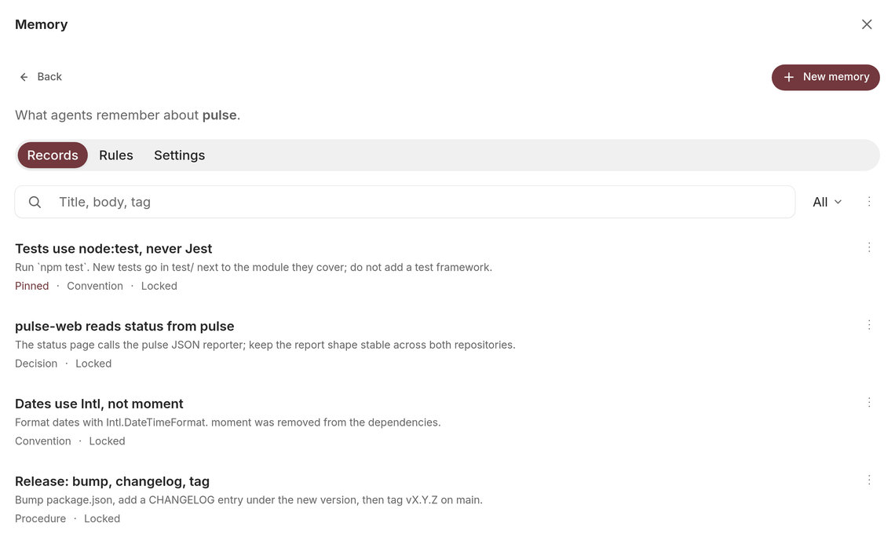</td>
    <td>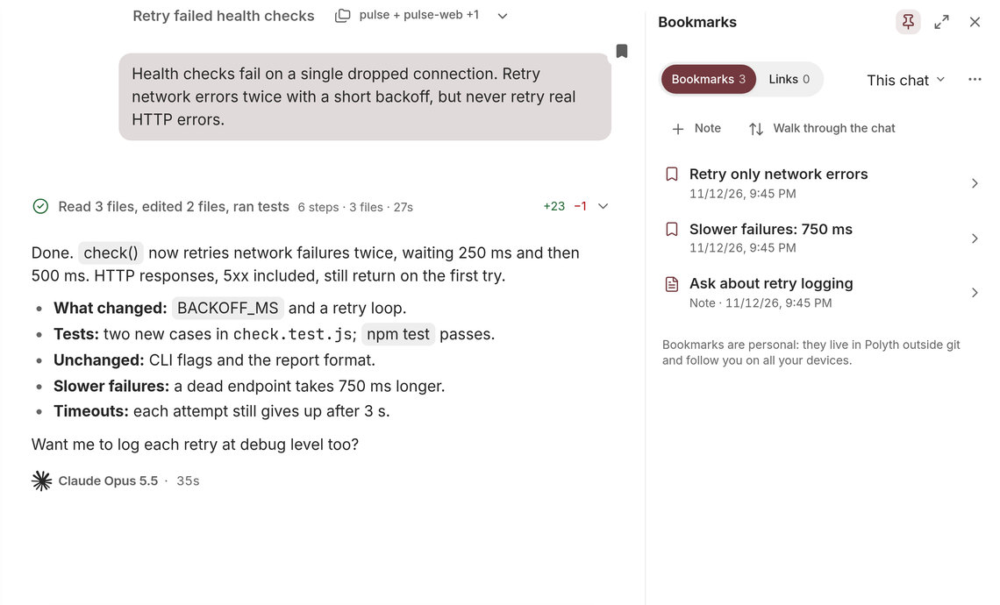</td>
  </tr>
  <tr>
    <td><em>Memory that every agent shares, whichever harness it runs on.</em></td>
    <td><em>Bookmark the answers worth keeping and walk back through them.</em></td>
  </tr>
</table>

- **Source control.** Diffs, staging, commits, log, branches, stashes and worktrees;
  GitHub pull requests and checks, GitLab issues, merge requests and pipelines.
- **Files and terminal.** A file browser and editor with conflict guards, and a
  terminal with tabs, replay and extra keys on phones.
- **Resident agents and Planner.** Named agents wake on a schedule, on a heartbeat or
  when asked, and keep a notebook. Plan one-off and recurring prompts, down to cron,
  in your time zone.
- **Multirun and Judges.** Send one prompt to several models side by side and keep the
  best answer. An independent judge checks whether a turn did what it promised.
- **Web search built in.** Agents search the web and read pages without an API key.
- **Remote over SSH.** Open a project on another machine and run the agent next to the
  files.
- **Voice mode.** Talk, pause, and hear the reply while it is still being written.
  Dictation everywhere else.
- **Your tools.** Jira, Trello, Linear, GitHub, GitLab, Gmail, Calendar, Drive and MCP
  servers; one-tap custom actions, slash commands, `#` snippets and skills.
- **Usage and limits.** Tokens, cost and time per session, project and server; live
  provider limits with a pace warning, a peak-rate chip beside the model, and limit
  windows that start at the hour you choose.
- **Not just code.** Research and everyday projects start without picking a folder.
- **Command line.** Script Polyth with [`polyth`](docs/dev/cli.md): create chats, send,
  follow and wait, with JSON output.

Packages marked Beta ship switched off on fresh installs and say so in Settings →
Packages. [CHANGELOG.md](CHANGELOG.md) lists what landed recently.

## Start at your desk. Answer from your phone.

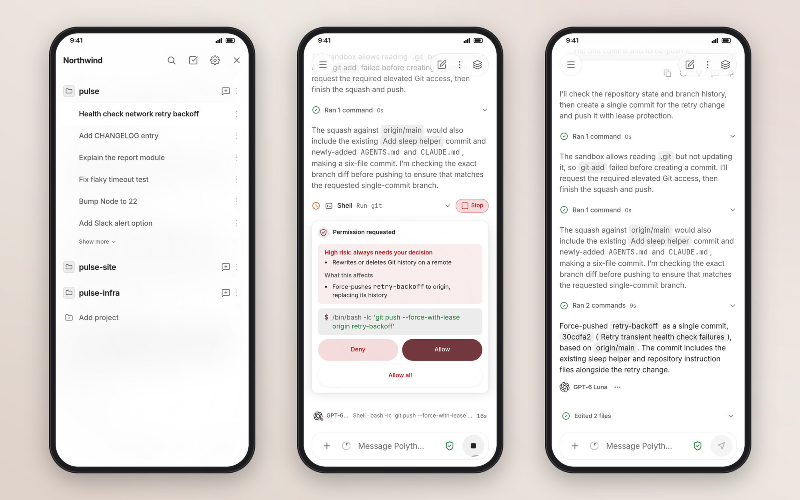

The same chats in the browser, the desktop app and on your phone. Pair once by QR
code, nearby discovery or a six-digit code, approve it on the computer, and it
reconnects on its own. Notifications tell you when an agent is done or needs an
answer, and you can give that answer right there.

## Get Polyth

| Platform | What you get |
|---|---|
| **macOS** | Signed and notarized DMG for Apple silicon and Intel, macOS 13 or newer (a separate Intel build runs on macOS 12) |
| **Windows** | Installer for 64-bit Windows |
| **Linux** | AppImage for x86-64 |
| **Android** | APK as a direct download |
| **iPhone and iPad** | Coming to the App Store |

All builds are on [polyth.app/download](https://polyth.app/download/). The desktop app
brings its own server, OpenCode and Chromium; install the other coding agents you want
and sign in to them as usual. It updates itself and lets you pick a release channel.

For a team, run one Polyth server on a machine everyone can reach (a workstation, a
home server or a VPS). People sign in from any browser and pair their phones to it.

Polyth is free and open source under the Apache License 2.0, with no paid edition. You
keep paying your agent providers as you do today: Polyth runs the command-line agents
you have already installed and signed in to. Projects, history, settings and secrets
stay on the machine that runs Polyth.

## Quick start

From source you need **Node.js 22.16 or newer** and at least one supported agent CLI
installed and signed in: [Claude Code](https://code.claude.com/docs/en/setup),
[Codex](https://github.com/openai/codex), [OpenCode](https://opencode.ai), Pi,
Antigravity, Cursor, [DeepSeek Harness](https://github.com/deepseek-ai/deepseek-harness)
(`dsh`) or [GitHub Copilot CLI](https://github.com/github/copilot-cli). The `gh` CLI
(GitHub features) and Chromium (the built-in browser) are optional.

```bash
git clone https://github.com/Polyth/Polyth.git && cd Polyth
npm install
npm run build          # bundles the web app and every package
npm run setup:claim    # first run only, with the server stopped: prints a setup token
npm start              # http://127.0.0.1:4400
```

Open the page, paste the claim token, create the owner account and store the recovery
codes. Restart the server once after setup, then add a project and start a session.

## Run it your way

Polyth is always one server that owns your data, sessions and agent runtimes; the
browser, the desktop window and the phone are clients.

| Setup | Reach it from | Start here |
|---|---|---|
| Local from source | this machine's browser | `npm start` |
| Development supervisor | this machine's browser | `npm run watch` |
| Docker | this machine, or any browser behind Caddy HTTPS | `docker compose -f deploy/docker/compose.yml up -d` |
| Your own HTTPS reverse proxy | any browser via your proxy | `POLYTH_PUBLIC_ORIGIN` |
| Desktop app | the app window, or another Polyth by Link or address | [download](https://polyth.app/download/) or `npm run desktop:dev` |
| Phone via Polyth Link | Android or iOS app, paired | `npm run build:mobile` |
| Disposable beta | this machine, no login, temporary data | `npm run agent:beta` |

Environment variables, Docker and proxy setup, the desktop and mobile builds and the
debug modes are in [Ways to run Polyth](docs/operations/running.md).

## How it works

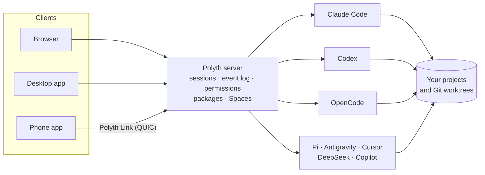

- **The server owns the truth.** Sessions, the event history, the message queue,
  projects, worktrees and Spaces live in Polyth. Native agent threads are subordinate
  runtime legs, and model-visible facts are persisted before anything is shown.
- **Polyth owns every process it starts.** Agent runtimes run under a small supervisor
  with durable release receipts, so a crash or restart is reconciled from confirmed
  history instead of guesses.
- **Everything is a package.** Each feature ships its server entry, routes, UI and
  scoped CSS as one package under `packages/`, registered through `@polyth/plugins`
  and `@polyth/web-sdk`.
- **TypeScript without a build step on the server.** Node runs the sources directly
  with type stripping; the web app is bundled with esbuild.

## Documentation

| Topic | Where |
|---|---|
| Ways to run: source, Docker, proxy, desktop, phone | [docs/operations/running.md](docs/operations/running.md) |
| System as built: packages, protocol, events, UI slots | [docs/dev/architecture.md](docs/dev/architecture.md) |
| Build a feature from zero | [docs/dev/README.md](docs/dev/README.md) |
| Harnesses, switching and delegation | [docs/architecture/multi-harness.md](docs/architecture/multi-harness.md) |
| Spaces, accounts and sharing | [docs/architecture/spaces-and-tenancy.md](docs/architecture/spaces-and-tenancy.md) |
| Polyth Link and mobile | [docs/architecture/polyth-link.md](docs/architecture/polyth-link.md), [docs/mobile/](docs/mobile/) |
| Docker and releases | [docs/operations/docker.md](docs/operations/docker.md), [docs/operations/releases.md](docs/operations/releases.md) |
| UI style guide and design system | [docs/dev/styles.md](docs/dev/styles.md), [docs/dev/design-system.md](docs/dev/design-system.md) |
| Rules for coding agents working on this repo | [AGENTS.md](AGENTS.md), [docs/agents/](docs/agents/README.md) |

## Development

```bash
npm run watch                        # build, start, rebuild and restart on change
npm run watch -- --restart=never     # rebuild without restarting the server
node --experimental-strip-types --test packages/<package>/test/*.test.ts
npm test                             # the whole node:test suite; slow and partly environment-dependent
```

There is no root typecheck script; run
`node node_modules/typescript/bin/tsc --noEmit -p packages/<package>/tsconfig.json`
for each project you touch. [CONTRIBUTING.md](CONTRIBUTING.md) covers conventions,
tests and pull requests.

## Support

Polyth is independent: no ads and no paid edition, and every feature is in the same
Apache-2.0 app. If it earns a place in your day, support its development on
[Patreon](https://www.patreon.com/c/polyth);
[polyth.app/donate](https://polyth.app/donate/) lists the ways to help without money.

## Contributing and security

Contributions are welcome; start with [CONTRIBUTING.md](CONTRIBUTING.md). Pull
requests target `devel`, where nightly builds come from; `master` is the release line
and carries every package except the unfinished previews
([branches](docs/operations/releases.md#branches-devel-and-master)). Please report
vulnerabilities privately as described in [SECURITY.md](SECURITY.md), and follow the
[code of conduct](CODE_OF_CONDUCT.md).

## License

Polyth is licensed under the [Apache License 2.0](LICENSE).
