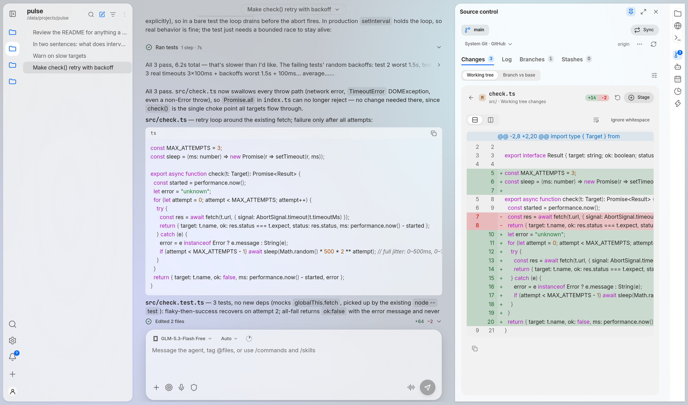
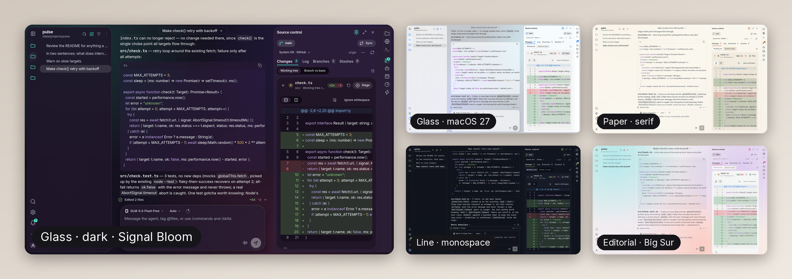
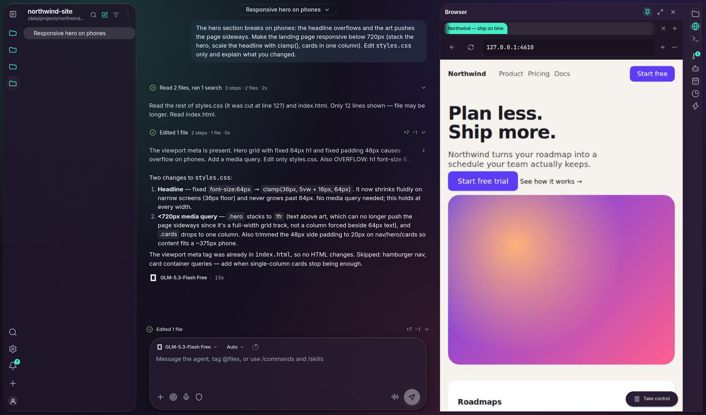
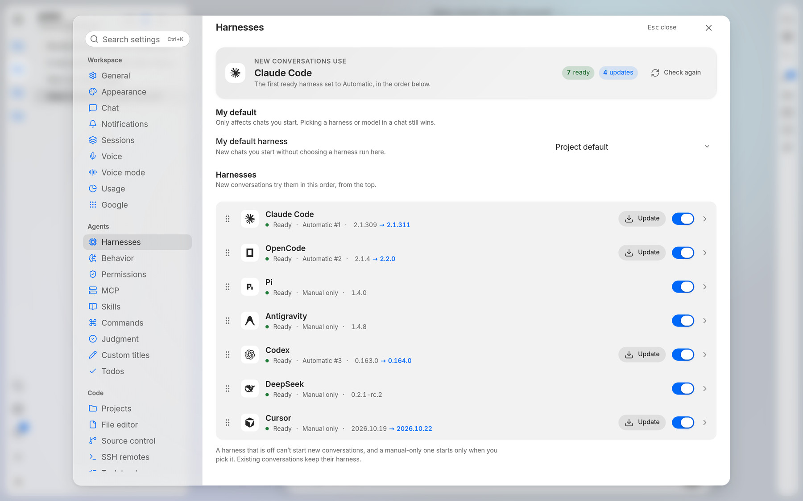
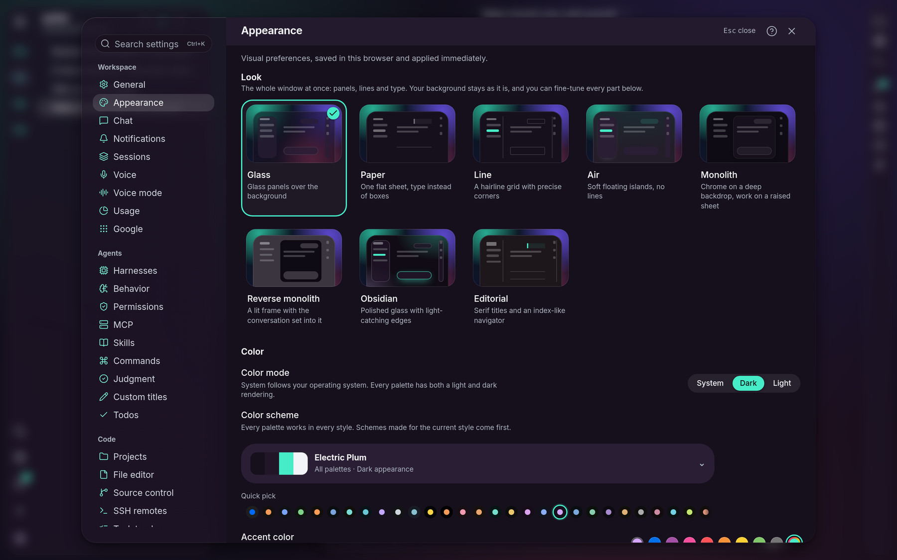
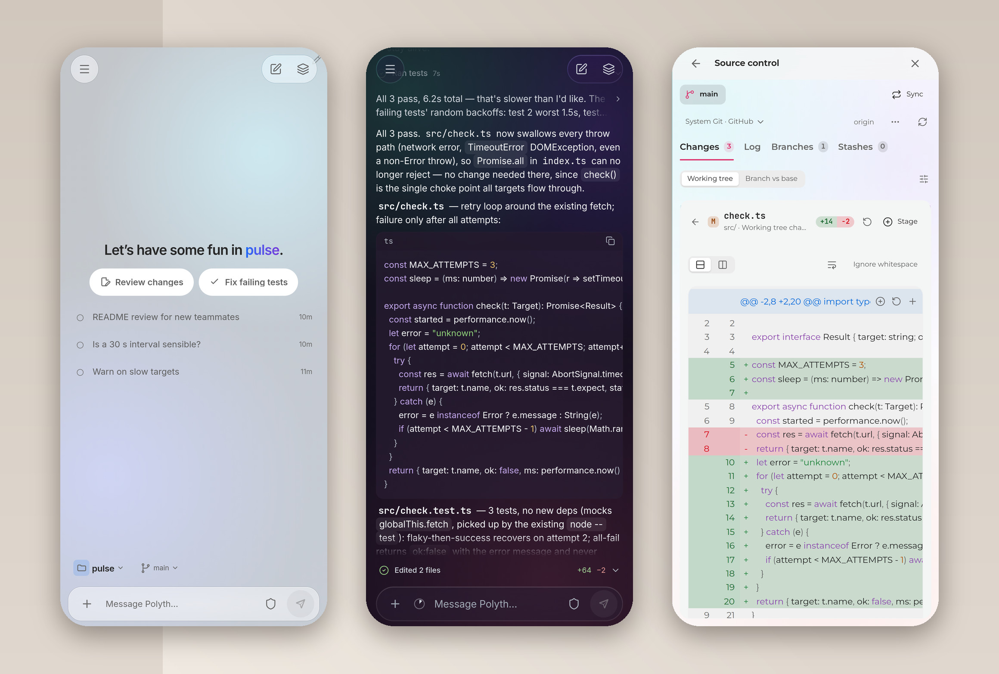
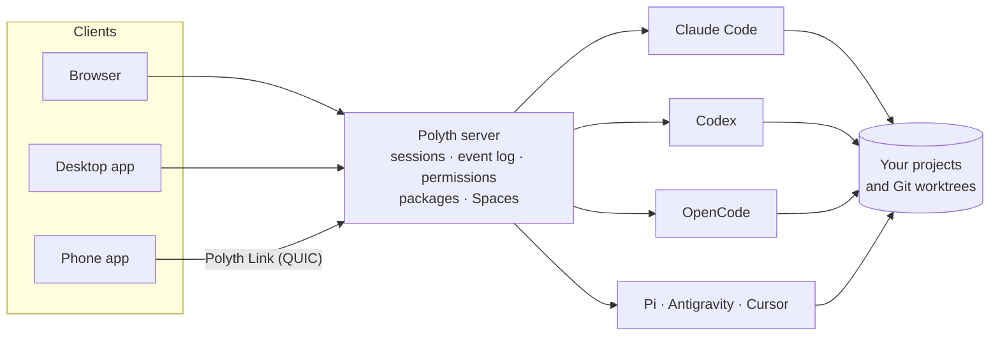

<div align="center">


# Polyth

**One workspace for every coding agent. And everyone you build with.**

Run Claude Code, Codex, OpenCode, Pi, Antigravity, Cursor and DeepSeek on one
permanent history. Share a server with your team, keep risky actions behind a person,
and reshape every part of the interface.

[Download](https://polyth.app/download/) · [Quick start](#quick-start) · [What's different](#four-ideas-built-in-from-day-one) · [Ways to run](#ways-to-run-polyth) · [Architecture](#architecture) · [Docs](#documentation) · [Support on Patreon](https://www.patreon.com/c/polyth) · [polyth.app](https://polyth.app)

<sub>Open source · macOS, Windows, Linux and Android · or your own server</sub>

</div>



<p align="center"><em>An agent added retries to a small project, ran the tests and explained its choices. The diff is one click away in the Source control panel.</em></p>

<div align="center">

**7** coding agents on one history · **80+** packages to switch, swap or fork · **12** interface languages · **0** ports to open for your phone

</div>

## Four ideas, built in from day one

- **One history, any agent.** Switch agents mid-conversation and keep every word.
- **Safe by default.** Risky calls wait for a person.
- **Built for a team.** One server, everyone on it: personal accounts, private chats,
  sharing, roles and limits.
- **Yours to reshape.** Every feature is a package. Switch it off, install a new one
  from a link, or have an agent build it.

### The conversation belongs to you

Every chat is a permanent record that Polyth keeps: a canonical, append-only event
log. The agent CLI underneath (a *harness*) only runs the current turn, so you can
change it any time, and nothing is silently rewritten.

- **Switch mid-conversation.** Start on Claude Code, continue on Codex, finish on a
  local model through OpenCode or Pi.
- **Fork, rewind, redo.** Branch from any message, or step back without losing the
  original. Queue messages and steer a turn while it runs.
- **Bring your history.** Import Claude Code, Codex, OpenCode, Pi and Cursor
  conversations and continue them on any agent.
- **Delegate across agents.** An agent can start helpers on other agents, each in your
  checkout or its own Git worktree, and merge their work back.
- **Rich answers.** Markdown, Mermaid diagrams, math, sortable tables, charts, forms and
  option cards rendered inline.

Supported harnesses: Claude Code (Agent SDK), Codex (App Server), OpenCode, Pi,
Antigravity, Cursor and DeepSeek (`dsh`), with Command Code in beta. Polyth reuses
their existing sign-in; new chats start on the first ready agent in your order, or on
the one you pick for a chat or a project.

### One server for everyone you build with

Not a single-user remote with a shared password. Each person signs in as themselves,
chats stay private until they are shared, and the owner decides what every account
may do.

- **Spaces with real boundaries.** A Space owns its projects, chats, files, worktrees,
  knowledge, secrets and integrations. Keep home, work and client projects apart; the
  server checks membership on every request. Roles: Owner, Admin, Member, Viewer.
- **Private by default.** New chats are private. Share one with specific people or the
  whole Space, to read along or to work in it together. Admins cannot open private
  chats.
- **Who said what.** Every message shows its author, and the agent works with the
  sender's accounts.
- **Talk to people too.** @-mentions and notifications; turn any thread into an agent
  session in one step.
- **Limits per account.** Allowed projects and assistants, and messages or new chats
  per day, with today's use always visible.
- **Protected mode.** No composer shell, no Auto-approve: a person answers every
  request.

### Agents do the work. People make the risky calls.

A permission engine that refuses when in doubt sits between every agent and your
machine. Choose a level for the Space and the project, and override it per chat;
helper agents inherit their parent's level.

| Level | What happens |
|---|---|
| **Ask** | Every request waits for an answer: once, for this chat, or always for the project. |
| **Auto-approve** | Routine work flows. Deletes, force-pushes, sudo, credential access, deploys and writes outside the project still wait for a person. |
| **Full access** | Everything not blocked by an explicit deny rule runs. Opt-in, confirmed, and best kept for throwaway environments. |

- **Deny rules always win**, at every level including Full access.
- **No self-promotion.** An agent may turn its autonomy down, never up. Command-line
  and automation tokens can run agents but never answer a permission request.
- **Secrets stay sealed.** Credential Vault gives agents a handle, never the value; the
  server fills it into one command and redacts it from the output.
- **Default-deny devices.** A new phone can do nothing until you allow it, and access
  can be revoked at any time.
- **No open ports.** Phones connect through Polyth Link, an authenticated, encrypted
  QUIC tunnel.

The risk check reads what the agent says it is about to do. It is a tripwire, not a
sandbox: an agent's own tools still run with the permissions of the account that runs
Polyth. For hard isolation, run Polyth in a container or VM that holds only what the
agents should reach. [SECURITY.md](SECURITY.md) and
[polyth.app/security](https://polyth.app/security/) describe the full model.

### Not a settings page. A set of parts.

Polyth is a small host with more than 80 packages around it. Chat, source control,
the terminal, the browser, voice, resident agents, integrations, even support for
each coding agent: each brings its own server code, interface and styles, and plugs
into typed slots.

- **Turn off what you don't use.** Settings → Packages switches packages per Space.
  Previews ship off and are marked Beta.
- **Remove it cleanly.** A package is one folder. The host never refers to it by name,
  so removing it leaves nothing behind.
- **Install from a link.** A GitHub, GitLab or Codeberg repository, a branch or tag, a
  `.zip` URL, or a folder on your computer. Review the access it asks for and grant it
  for this Space only.
- **Updates you approve.** Let packages update themselves; an update that asks for new
  access waits for you. Or install as your own fork and keep your edits on top.
- **Built by an agent.** Polyth's own code is written to be changed by coding agents:
  shared rules, skills for every area, a package SDK and typed UI slots. Describe a
  feature in a chat on Polyth's own code and get it as a package.

Appearance is a stack of independent choices: platform style (macOS Liquid Glass,
Windows 11 Fluent, macOS Big Sur or Polyth Classic), looks, light/dark/system, any
accent and your own JSON theme, workspace backgrounds and glass, fonts, density,
widget areas, rails and an optional status bar, an editable keymap with a command
palette, per-project or shared layouts, and twelve interface languages.



<table>
  <tr>
    <td colspan="2"></td>
  </tr>
  <tr>
    <td colspan="2"><em>The built-in browser is shared by you and the agent: preview your app next to the conversation and take control at any time.</em></td>
  </tr>
  <tr>
    <td width="50%"></td>
    <td width="50%"></td>
  </tr>
  <tr>
    <td><em>Bring the agents you already use. Polyth reuses their sign-in and starts new chats on the first ready one you set to Automatic.</em></td>
    <td><em>Make it yours: whole-window looks, platform styles, light and dark, any accent, workspace backgrounds, glass surfaces and density.</em></td>
  </tr>
</table>

### And everything around the code

- **Source control.** Diffs, staging, commits, log, branches, stashes and worktrees;
  GitHub pull requests and checks, GitLab issues, merge requests and pipelines.
- **A browser you share.** Preview your app beside the chat. The agent drives it
  (Chromium); you can take over at any moment.
- **Files and terminal.** A file browser and editor with conflict guards, and a
  terminal with tabs, replay and extra keys on phones.
- **Resident agents.** Named agents wake on a schedule, on a heartbeat or when asked,
  and keep a notebook.
- **Planner.** One-off and recurring prompts: at a time, every few hours or on a cron
  schedule, in your time zone.
- **Multirun.** Send one prompt to several models side by side and keep the best
  answer, or let Fusion merge them (beta).
- **Judges.** An independent check of whether a turn did what it promised, and which
  chats are waiting for you.
- **Remote over SSH.** Open a project on another machine and run the agent next to the
  files.
- **Voice mode.** Talk, pause, and hear the reply while it is still being written.
  Dictation everywhere else.
- **Knowledge and memory.** Notes, plans and reusable context you attach to any chat.
- **Your tools.** Jira, Trello, Linear, GitHub, GitLab, Gmail, Calendar, Drive, MCP
  servers and web search; one-tap custom actions, slash commands, `#` snippets and
  skills.
- **Command line.** Script Polyth with [`polyth`](docs/dev/cli.md): create chats, send,
  follow and wait, with JSON output.
- **Usage and limits.** Tokens, cost and time per session, project and server, and live
  provider limits with a pace warning.

Packages marked beta ship switched off on fresh installs and say so in Settings →
Packages. [CHANGELOG.md](CHANGELOG.md) lists what landed recently.

### Start at your desk. Answer from your phone.

The same chats in the browser, the desktop app and on your phone. Pair once by QR
code, nearby discovery or a six-digit code, approve it on the computer, and it
reconnects on its own. Notifications tell you when an agent is done or needs an answer.



## Get Polyth

| Platform | What you get |
|---|---|
| **macOS** | Signed and notarized DMG for Apple silicon and Intel |
| **Windows** | Installer for 64-bit Windows |
| **Linux** | AppImage for x86-64 |
| **Android** | APK as a direct download |
| **iPhone and iPad** | Coming to the App Store |

All builds are on [polyth.app/download](https://polyth.app/download/). The desktop app
brings its own server, OpenCode and Chromium; install the other coding agents you want
to use and sign in to them as usual. It can update itself and lets you pick a release
channel in its settings.

For a team, run one Polyth server on a machine everyone can reach (a workstation, a
home server or a VPS). People sign in from any browser and pair their phones to it.

Polyth is free and open source under the Apache License 2.0. You keep paying your agent
providers as you do today: Polyth runs the command-line agents you have already
installed and signed in to. Projects, history, settings and secrets stay on the
machine that runs Polyth.

## Quick start

From source you need **Node.js 22.16 or newer** and at least one supported agent CLI
installed and signed in: [Claude Code](https://code.claude.com/docs/en/setup),
[Codex](https://github.com/openai/codex), [OpenCode](https://opencode.ai), Pi,
Antigravity, Cursor or [DeepSeek Harness](https://github.com/deepseek-ai/deepseek-harness)
(`dsh`). The `gh` CLI (GitHub features) and Chromium (the built-in browser) are
optional.

```bash
git clone https://github.com/Polyth/Polyth.git && cd Polyth
npm install
npm run build          # bundles the web app and every package
npm run setup:claim    # first run only, with the server stopped: prints a setup token
npm start              # http://127.0.0.1:4400
```

Open the page, paste the claim token, create the owner account and store the recovery
codes. Restart the server once after setup, then add a project folder and start a
session.

Prefer containers? `docker compose -f deploy/docker/compose.yml up -d`. See
[Docker](#docker).

## Ways to run Polyth

Polyth is always one server that owns your data, sessions and agent runtimes. The
clients (browser, desktop window, phone) connect to it.

| Setup | Server runs | Reach it from | Start here |
|---|---|---|---|
| [Local from source](#local-from-source) | your machine, `npm start` | this machine's browser | `npm start` |
| [Development supervisor](#development) | your machine, auto-rebuild and restart | this machine's browser | `npm run watch` |
| [Docker, this machine](#docker) | container on Linux, host network | this machine's browser | `deploy/docker/compose.yml` |
| [Docker behind HTTPS](#docker) | container and Caddy TLS proxy | any browser, `https://your.domain` | `deploy/docker/compose.proxy.yml` |
| [Your own HTTPS reverse proxy](#behind-your-own-https-reverse-proxy) | your machine or VPS, `npm start` | any browser via your proxy | `POLYTH_PUBLIC_ORIGIN` |
| [Desktop app](#desktop-app) | inside the app (bundled OpenCode and Chromium) | the app window | `npm run desktop:dev` |
| [Phone via Polyth Link](#phones-and-remote-devices) | any of the above | Android or iOS app, paired | `npm run build:mobile` |
| [Disposable beta](#debug-and-disposable-modes) | temporary data, loopback | this machine, no login | `npm run agent:beta` |

### Local from source

The [quick start](#quick-start) above. The server binds `127.0.0.1` and keeps
everything in `POLYTH_DATA_DIR`.

| Variable | Default | Meaning |
|---|---|---|
| `PORT` | `4400` | HTTP port |
| `HOST` | `127.0.0.1` | Listen address. Without a public origin, browser sign-in works only over direct loopback |
| `POLYTH_DATA_DIR` | `./data` | Data directory (one running server per directory) |
| `POLYTH_PUBLIC_ORIGIN` | none | HTTPS origin when published behind a TLS proxy (requires `POLYTH_TRUSTED_PROXIES`) |
| `POLYTH_TRUSTED_PROXIES` | none | Comma-separated exact proxy addresses allowed to report forwarded TLS |
| `POLYTH_CHROMIUM_PATH` | auto | Chromium executable for the built-in browser |
| `POLYTH_LINK_HOST` | auto | `polyth-link-host` executable (otherwise `target/release` after `npm run build:link`) |
| `POLYTH_DEBUG_AGENT_ACCESS` | none | `1` allows loopback API access without sign-in, see [debug modes](#debug-and-disposable-modes) |

### Docker

The root [`Dockerfile`](Dockerfile) builds the server with its web bundles, the
runtime supervisor, a pinned OpenCode binary, `git`, `gh` and the Polyth Link host;
the `polyth-browser` target adds Chromium. Data, home (agent sign-ins) and your
projects are volumes: `/data`, `/home/node` and `/workspace`.

```bash
cd deploy/docker
cp .env.example .env                        # set POLYTH_UID/GID to `id -u`/`id -g` and POLYTH_WORKSPACE
mkdir -p workspace                          # default POLYTH_WORKSPACE, mounted at /workspace
docker compose build
docker compose run --rm polyth setup-claim  # first run, server stopped
docker compose up -d                        # http://127.0.0.1:4400; `docker compose restart polyth` after setup
```

`compose.yml` uses host networking (Linux Docker Engine) because a published bridge
port does not arrive over loopback and sign-in would be refused. For access from
other machines use `compose.proxy.yml`, which puts Polyth behind Caddy with automatic
HTTPS on `POLYTH_DOMAIN`. Image variants, build arguments, agent sign-in, upgrades and
backups are in [Running Polyth in Docker](docs/operations/docker.md).

### Behind your own HTTPS reverse proxy

Run the server on a non-loopback address and declare the public origin and the
proxy's exact address:

```bash
HOST=0.0.0.0 POLYTH_PUBLIC_ORIGIN=https://polyth.example.com POLYTH_TRUSTED_PROXIES=10.0.0.5 npm start
```

The proxy must terminate TLS, forward the original `Host` and set
`X-Forwarded-Proto: https`; forwarded headers from any other peer are ignored. Never
expose plain HTTP on a public interface. The first-run setup page does not accept
proxy-terminated TLS, so create the owner account once over loopback (plain
`npm start`, or an SSH tunnel), then start with the public origin.

### Desktop app

Polyth Desktop (Electron) runs its own loopback server with bundled OpenCode and
Chromium and handles first-run setup itself. Installers (AppImage, DMG, NSIS EXE) are
on [polyth.app/download](https://polyth.app/download/); release channels and the
update feed are described in [Releases](docs/operations/releases.md). From source:

```bash
npm run desktop:dev          # build, download the pinned OpenCode, launch
npm run desktop:dist:linux   # or desktop:dist:mac / desktop:dist:win
```

See [Polyth Desktop](docs/dev/desktop.md).

### Phones and remote devices

The Android and iOS app is a client for an existing Polyth server. Pair it by QR code,
nearby discovery or a six-digit code, approve it on the computer, and it reconnects on
its own afterwards. The host needs the `polyth-link-host` executable
(`npm run build:link`; bundled in the desktop app and the Docker image). Build the app
with `npm run build:mobile`, then `npm run mobile:open:android` or
`npm run mobile:open:ios`. See [Polyth Link on mobile](docs/mobile/polyth-link.md).

### Debug and disposable modes

- `npm run agent:beta` builds and runs a disposable loopback instance with temporary
  data and no sign-in. Workspace writes and mutating shell commands are denied, and the
  data is removed on exit.
- `POLYTH_DEBUG_AGENT_ACCESS=1 npm start` lets direct loopback HTTP and WebSocket
  requests act as the active owner without signing in. It never applies to Polyth Link
  ingress, and identity and setup endpoints keep their CSRF and origin checks.
- `npm run auth:break-glass -- --help` is offline owner password recovery for a stopped
  server.
- [`polyth`](docs/dev/cli.md) is a command-line client for a running server or Polyth
  Desktop.

## Architecture



- **The server owns the truth.** Sessions, the event history, the message queue,
  projects, worktrees and Spaces live in Polyth. Native agent threads are subordinate
  runtime legs, and model-visible facts are persisted before anything is shown.
- **Polyth owns every process it starts.** Agent runtimes run under a small supervisor
  with durable release receipts, so a crash or restart is reconciled from confirmed
  history instead of guesses.
- **Everything is a package.** Each feature ships its server entry, routes, UI and
  scoped CSS as one package under `packages/`, registered through
  `@polyth/plugins` and `@polyth/web-sdk`. Optional packages can be removed as a
  single folder.
- **TypeScript without a build step on the server.** Node runs the sources directly
  with type stripping; the web app is bundled with esbuild.

Start with [docs/dev/architecture.md](docs/dev/architecture.md) for the full picture.

## Documentation

| Topic | Where |
|---|---|
| System as built: packages, protocol, events, UI slots | [docs/dev/architecture.md](docs/dev/architecture.md) |
| Build a feature from zero | [docs/dev/README.md](docs/dev/README.md) |
| Harnesses, switching and delegation | [docs/architecture/multi-harness.md](docs/architecture/multi-harness.md) |
| Spaces, accounts and sharing | [docs/architecture/spaces-and-tenancy.md](docs/architecture/spaces-and-tenancy.md) |
| Polyth Link and mobile | [docs/architecture/polyth-link.md](docs/architecture/polyth-link.md), [docs/mobile/](docs/mobile/) |
| Docker and releases | [docs/operations/docker.md](docs/operations/docker.md), [docs/operations/releases.md](docs/operations/releases.md) |
| UI style guide and design system | [docs/dev/styles.md](docs/dev/styles.md), [docs/dev/design-system.md](docs/dev/design-system.md) |
| Rules for coding agents working on this repo | [AGENTS.md](AGENTS.md), [docs/agents/](docs/agents/README.md) |

## Development

```bash
npm run watch                        # build, start, rebuild and restart on change
npm run watch -- --restart=never     # rebuild without restarting the server (handy while agents work)
node --experimental-strip-types --test packages/<package>/test/*.test.ts
npm test                             # the whole node:test suite; slow and partly environment-dependent
```

`npm run watch` restarts the server for `packages/*/src` changes, rebuilds bundles for
`packages/*/widgets` and `apps/web/src` changes, and restarts the server with backoff
if it exits. File watching is only a latency optimization: the supervisor also sweeps
the source roots every couple of seconds, so a change whose event was dropped is still
rebuilt. `npm run watch -- --help` lists the flags.

There is no root typecheck script; run
`node node_modules/typescript/bin/tsc --noEmit -p packages/<package>/tsconfig.json`
for each project you touch. [CONTRIBUTING.md](CONTRIBUTING.md) covers conventions,
tests and pull requests.

## Support

Polyth is independent: no ads and no paid edition, and every feature is in the
same Apache-2.0 app. If it earns a place in your day, you can support its
development on [Patreon](https://www.patreon.com/c/polyth).
[polyth.app/donate](https://polyth.app/donate/) lists the ways to help without
money.

## Contributing and security

Contributions are welcome; start with [CONTRIBUTING.md](CONTRIBUTING.md). Pull
requests target `devel`, where nightly builds come from; `master` is the release
line and carries every package except the unfinished previews
([branches](docs/operations/releases.md#branches-devel-and-master)). Please
report vulnerabilities privately as described in [SECURITY.md](SECURITY.md), and
follow the [code of conduct](CODE_OF_CONDUCT.md).

## License

Polyth is licensed under the [Apache License 2.0](LICENSE).
