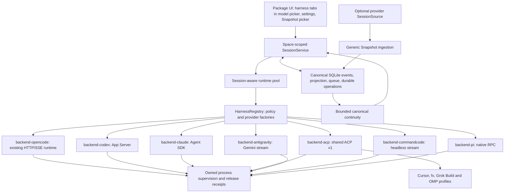

# Polyth multi-harness foundation

This document describes the current multi-harness implementation.

Polyth owns the conversation, queue, project and worktree relationship. A harness supplies an `AgentRuntime`. Switching changes the runtime leg of the existing canonical session.

## Architecture



The new registry selects factories. It does not replace `AgentRuntime`, reconciliation, endpoint identity, the durable operation journal, or the existing runtime epoch transaction. Providers register through package discovery and the existing service registry. The desktop's generated-style package inventory mirrors server discovery. A local provider daemon launched by Polyth is an implementation detail inside that ownership boundary; it is never an ambient service that Polyth merely hopes to find again.

`backend-opencode` registers the existing managed OpenCode pool. Its existing composition-root wiring still owns configuration restart barriers and shared-project runtime management; this was preserved deliberately. No central session or importer switch statement dispatches on Claude, Codex, Cursor, fx, or other vendor names.

Runtime pool keys include Space, project, cwd, canonical session and harness. Settings persist under `host.spaceStorage(ctx)`. Routes resolve scoped services through `host.forSpace(rc.space)`. Native history handles are bound to the validated Space and project.

Session debug can expose a bounded, volatile `spawnTiming` sample for a session
created by the current service. Runtime reuse evidence belongs to the exact
canonical lease even when several sessions share a physical facade. Measurement
boundaries and absent-field semantics are defined in the
[performance contract](../agents/performance.md#session-spawn-timing).

Harness packages resolve the registry and runtime services only from `onEnable`, register once, and await asynchronous unregister from `onDisable`. Unregistration is fenced while the shared pool still holds a runtime lease for that provider, including pending and failed retirement; disabling the implementation package fails with a conflict. An asynchronous probe cannot select an unregistered provider, and runtime creation checks the exact registration again before launch. Pending or failed retirement also blocks replacement of that session's runtime until release succeeds. Server shutdown is the one exception to unregister fencing: it unregisters providers before the shared pool performs its final owned-runtime drain. Executable discovery returns a child environment scoped to that provider; adapters pass it to probes, ACP transports, SDK sessions and print-mode helpers instead of rewriting the server-wide `PATH`. `@polyth/backend-acp` is transport library code, not a discoverable user-facing package; Cursor, fx, Grok Build and OMP each own a concrete profile package and registration.

Detailed authentication evidence replaces the earlier probe's message and account state together. An `auth-required` result clears a previous authenticated claim and is never eligible for execution, even if other probe fields disagree.

### Harness accounts

Every local CLI harness except OpenCode and fx can run several native logins. The shared owner is `@polyth/harness-runtime/accounts` (`createHarnessAccountFamily`); a backend supplies only how its CLI is pointed at one login, a local status report and a sign-in command:

| Family | Account isolation | Local status report (never a model turn) |
| --- | --- | --- |
| `claude` | `CLAUDE_CONFIG_DIR=<dir>` | `claude auth status --json` |
| `codex` | `CODEX_HOME=<dir>` | `codex login status` |
| `cursor` | `XDG_CONFIG_HOME=<dir>/config`, a link-back overlay of `~/.config` whose `cursor` entry is private (Linux only; elsewhere the CLI ignores it) | `agent status --format json` |
| `grok` | `GROK_HOME=<dir>` | `grok models` |
| `deepseek` | `DSH_HOME=<dir>` (credential store, `.env`, profiles and sessions); the server's own `DEEPSEEK_API_KEY` is removed from an account's environment, because dsh lets the launch environment win over every store | none: `dsh` has no sign-in report, so status is `unknown` and the first turn verifies the key; the sign-in command is Polyth's hidden-input helper that writes `$DSH_HOME/.env` |
| `omp`, `pi` | `PI_CODING_AGENT_DIR=<dir>` | `omp models`, `PI_OFFLINE=1 pi --list-models` |
| `antigravity` | `HOME=<dir>`, a link-back overlay of the real home with a private `.gemini`; a runtime's private home takes its `.gemini` from there | `agy models` |
| `commandcode` | `HOME=<dir>`, a link-back overlay with a private `.commandcode` | `command-code status --json` |

The default harness keeps its id and the user's own login. Each account added under Settings → Harnesses → *harness* → Accounts registers an extra `<family>-<slug>` provider. Its probes, discovery, runtime, print-mode helper, capability projection, native commands, model catalog, sign-in command and transcript import all use the account directory (`<package storageDir>/<family>-accounts/<slug>`). A link-back overlay links every real entry except the CLI's own credential directory, so tools the agent runs keep their git, ssh and package-manager state; it is refreshed before each status read and launch. The account list is deployment-wide host state, like the CLI credentials it points to. Its routes (`/api/backend-<family>/accounts`) are local-only, and only a `local-trusted` deployment may change it, by the instance owner or an account the owner gave `harnesses.manage` or `harnesses.personal`; such an account's additions (and the owner's with `private: true`) are private to it (`ownerUserId`, `accountOwnerUserId`, never Auto), and the owner or a manager may limit a shared account to some people and Spaces — see [Spaces and tenancy §13](spaces-and-tenancy.md#13-account-permissions-managing-assistants). The default harness registers synchronously and is never blocked by a broken account list. A native transcript lives in its account's directory, so a session resumes on the account that created it. Moving a conversation to another account is an ordinary harness switch with continuity transfer. Descriptors carry `accounts: { family, endpoint }` (roster and snapshots too), which shows the shared Accounts section and keeps the family logo, plus a live `accountLabel` and name, so a rename needs no re-registration; the picker keeps the shared logo, gives each extra login its own color (a Space color when one is set, otherwise a stable per-account tint) and names the account on hover. The harness list and the default-harness card also show the account label beside a Space title, so reaching the right login needs no visit to its detail page. Adding an account whose harness cannot register rolls the list back. Removing one unregisters it through the same lease fence, so removal fails while a session still holds that runtime. The directory is kept, and re-adding the same name restores the login and history (for a private account, only to the same user). A model list is not sign-in evidence: Claude and Codex discovery report `auth-required` when the CLI's local report says the login is signed out (unless a key is set in the environment).

OpenCode is not covered: it already holds several provider logins in one shared per-project server, and a second account would need a second server fleet plus id-specific UI. fx is not covered because its credential location could not be verified on this host.

A harness that runs several native logins registers each extra account as its own `<harness>-<account>` provider and names it with `HarnessDescriptor.accountLabel`. Each such provider also answers the server-only `HarnessProvider.limitsAccount()` with the limits family and the account's private configuration directory. Usage then reports that account's own limits under the harness id and never falls back to another login. Analytics labels the account by its live descriptor name. See [Usage limits](../../packages/usage/README.md#harness-accounts).

## Delegation ownership

Polyth, not the selected harness, owns agent delegation. The only supported product spawn path is the Polyth session-control capability `agent.spawn`. It creates an ordinary canonical session with `parentId` pointing to the caller; nested workers therefore form the same durable session tree that the sidebar, notifications, recovery, authorization and event replay already understand. The caller chooses whether the child shares its checkout or works in its own isolated worktree that it must merge back ([workspace choice](../agents/orchestration.md#choosing-the-workers-workspace)).

The harness registry and runtime pool normalize every provider to `subagents: false` and remove native-only `mode: "subagent"` descriptors before they reach product surfaces. Adapters then use provider-specific defense in depth: Claude disables Agent/Task, owned OpenCode denies its native task permission locally and over SSH, Command Code hides custom subagents and blocks delegation-family tools in its Mod, and Antigravity keeps its PreToolUse bridge active under its native launch bypass (the native CLI still runs PreToolUse hooks with `--dangerously-skip-permissions`). Antigravity denies every native agent surface observed in its CLI 1.2.11 `init` frame before Auto-Approve: `invoke_subagent`, `define_subagent`, `manage_subagents`, `manage_task` and `browser_subagent`, plus a narrow future `<verb>_agent(s)` / `<verb>_subagent(s)` suffix rule. `manage_task` is a conservative deny because only its name, not its exact semantics, was verified. DeepSeek Harness runs with a Polyth `--patch` overlay that disables its in-process subagent providers and every spawning tool (`subagent`, `subagent_fork`, `workflow`, `list_agents`, `send_message`, `interrupt_agent`, Ralph loops); the model's tool roster was verified without them on dsh 0.2.0-rc.2. An SSH host has no copy of the overlay, so a remote DeepSeek leg keeps dsh's native subagents. Codex, Pi and generic ACP already expose no Polyth native-subagent capability. A provider that offers no hard native-disable API is still governed by the mandatory Polyth delegation instruction; the adapter must not claim structural prevention it cannot prove.

Native-child discovery/recovery code may remain only for compatibility with pre-existing/imported provider state. It is not a creation path for new delegated work.

The tool execution watchdog pauses a tool while its owning canonical session has
an associated pending permission, question or secret request. Native permissions
correlate by call ID; package-tool approvals correlate by tool name. Closing the
associated requests gives that still-active tool a fresh execution limit.
Unrelated tools and mirrored child requests retain their execution limits. On
restart, durable open requests restore the pause. Codex rejects a permission
response whose local native request is already absent before delivery, allowing
the canonical request to expire without an unknown mutation blocking subsequent
turns. Transport failures and lost mutation acknowledgements remain uncertain
and are never replayed.

### What Auto-Approve can enforce per harness

Auto-Approve, its high-risk hold and Full access (see F18 in
`docs/dev/architecture.md`) act only on requests a harness sends to Polyth.
Source-inspected per adapter:

| Harness | Reaches Polyth's decision point | Not covered |
| --- | --- | --- |
| Claude Code | Every `canUseTool` call (command or file path as the pattern). | Tools the SDK's `default` mode allows natively (read-only tools). |
| Codex | Command and file-change approval requests. | Actions inside the `workspace-write` sandbox run without a request; only escalations ask, and a file-change request carries a reason rather than its paths. |
| OpenCode | Native permission events (patterns and metadata). | Whatever the project's own OpenCode permission config allows natively. |
| ACP (Cursor, Grok Build, oh-my-pi, fx, generic) | `session/request_permission`. | Only the tool-call kind and title are mapped, so risk is judged from the title. |
| Antigravity | Every gated tool, through the PreToolUse bridge under the native launch bypass. | Workspace reads/edits and the turn's staged attachments, which the bridge allows itself. |
| Command Code | Polyth package tools only. | Native built-in tools: Auto-Approve maps to native `auto-accept` (the hold cannot see them); otherwise native `dont-ask` denies what would prompt. |
| Pi | Polyth package tools only. | Pi's built-in tools: the adapter has no approval bridge, so they run without Polyth approval whatever the toggle says. |

## Session identity and routing

| Identity | Meaning |
| --- | --- |
| Polyth session ID | The durable product identity: one projection, timeline, title, queue, goals, project, and worktree relationship. |
| Runtime leg ID | One native execution context. Records harness, native ID, start time, bootstrap mode and canonical dialogue checkpoint. Closed legs remain in `harness/switched` events with an end time. |
| Native session/thread ID | A subordinate provider reference for execution, verified reattachment and reconciliation. It never becomes the Polyth session ID. |
| Runtime authority and generation | The execution ownership evidence used to fence observations and prove release. This is independent of native conversation identity. |

Title authority stays canonical. A harness declares `title: "native"` only when it publishes a semantic title (an event or a session-list name); a harness whose provider does not generate titles declares `title: "emulated"` so the canonical layer persists the prompt-derived fallback immediately, and an adapter may still publish a best-effort generated native name that refines that fallback. The runtime create/reset/resume input carries the projection's `titleSource` so an emulating adapter can tell a final title (`manual`/`native`/`generated`) from a Polyth prompt fallback (`polyth`) or placeholder: only the former suppresses harness-side generation, and a fallback is never written into a native session name as though it were authored. For a native-title harness, the session service reads the runtime's session list on a bounded schedule after the terminal event so a late title still wins, then settles on the prompt fallback if no semantic title materializes.

Runtime session lists retain native receipts even when a semantic title is unavailable. Their title must then be a recognized placeholder, such as `New session`, so polling leaves canonical fallback and Custom Titles eligible. The Claude adapter reports only the SDK's `customTitle` (a `/rename` title or Claude Code's own AI title, written a few seconds into the first turn) and uses this placeholder until one exists; `SDKSessionInfo.summary` falls back to the last or first prompt and is never a title. It reads the title after each completed request, at the turn's result and whenever the session list is polled. An engine label must not claim native-title authority. When a Custom Titles generator fails, the server uses a harness's native title before a truncated prompt.

New sessions persist `{ mode: "auto" }` separately from `resolvedHarnessId`. Auto uses deterministic priority and ID ordering (shipped defaults: Claude Code 0, OpenCode 10, Pi 20, Antigravity 30, Codex 50, DeepSeek 55, Cursor 60, Command Code 65; Harness Settings saves per-Space overrides), and stays on the persisted route. A Polyth-owned bundled runtime — the desktop's downloaded OpenCode — registers with a fallback priority, so Auto probes an enabled, installed and authenticated harness that the user has on the host first and keeps the download for when none is runnable; an explicit pin or a saved preference still overrides it. An explicit pin never silently selects another harness. Auto can try another ready factory when constructing a new, unbound session fails before native creation. Persisted routes do not use this fallback path.

A synchronized native leg can be reattached where the adapter supports verified continuity. Returning A → B → A creates a fresh A leg. A mismatch between the leg's effective dialogue checkpoint and current canonical history also forces fresh continuity. Profile intent survives switching, while the old profile's model/account selection is cleared. Model catalogs come from the selected session runtime; harness identity is not encoded into `providerID`.

## Safe switch algorithm

1. Under the existing session lock, persist a switch intent containing the target, timing and transition ID. Fence new turn admission; new messages can queue.
2. Default to finishing the active turn. “Stop and switch now” records explicit stop intent and uses existing abort machinery.
3. Reconcile the old runtime. A local idle marker, abort acknowledgement, timeout, disconnected channel or missing PID is not a release proof. Unresolved operations remain unresolved.
4. Require `releaseExecution` to confirm the exact old authority and generation. OpenCode's shared runtime barrier also rejects release while a neighbouring session on that authority is busy or unresolved.
5. Persist `harness/execution-released` before constructing the target runtime. Unwire the old runtime and evict its pool entry.
6. Prepare target native creation through the existing durable operation journal. A different harness is constructed without the source harness's model identity; same-harness fresh legs retain compatible launch settings. Persist the provider's exact native receipt. A missing response is never retried speculatively; recovery requires a matching operation receipt, not a title or timestamp guess.
7. Atomically publish the runtime epoch, target route, fresh leg, and closed prior leg. Clear transition state and stale model/profile routing in the same transaction.
8. Establish the fresh binding and reconciliation barrier, then admit the next turn with bounded canonical continuity. The canonical user event contains the user's text; recovery context is separately persisted and hidden by the timeline renderer.

A requested switch may obtain exact execution-release proof while an earlier
operation remains uncertain; only the subsequent epoch transaction may fence
that operation, and it is never replayed. If the old epoch cannot reattach,
the provider's durable authority release path can supply that proof without
loading native history, provided no other canonical session references the
authority or the same workspace route. Missing, uncertain or mismatched proof
leaves the requested target and queued intent intact and does not start it.
A same-harness transition (stale-history refresh or runtime restart) with
unchanged launch settings and no active rewind is the exception when that
release path is unavailable or shared on an owned runtime: it withdraws the
intent (`harness/switch-cancelled`, reason `replaced-by-runtime-epoch-recovery`)
and takes the owned-epoch recovery a send uses, rather than failing every later
send. Compacting an `epoch-pending` session likewise recovers the fresh epoch.

The canonical new-session row is visible while provider construction is still
in progress. A first prompt that repeats that row's route queues behind native
creation without fabricating an old execution to release. A genuinely different
submit-time route remains a durable requested transition; creation patches the
latest projection so the transition survives, and switching begins only after
the initial runtime publishes a releasable binding. The switch's internal abort
does not count as the user's standalone Stop and therefore does not pause that
queued prompt.

The target creation path uses the adapter's operation-aware fresh-session seam
directly for a different harness, which has no native history to reset. A
same-harness rewind or stale-leg replacement uses the reset seam so an adapter
cannot reuse its old canonical mapping; a confirmed old receipt is replaced
before retrying. Exact-history reset remains a compatibility fallback for
adapters without a usable fresh-session seam. Canonical continuity is transferred
separately and the native tail is never claimed to have been copied.

A crash after target creation but before publication resumes the recorded receipt. A target creation with no recoverable receipt stays blocked instead of making another native thread. A pending after-turn switch can be escalated to stop-now or retargeted from the harness tabs. Before release, the server changes the pending destination or cancels when the new choice resolves to the current harness. After release, a retarget receives a new transition ID and carries forward the exact release proof. While a transition is pending, the model picker previews that destination's catalog without binding a target runtime early. Picking a cross-harness search result in the composer stages the same next-turn harness switch as choosing that harness's tab, then binds the model; while a transition is pending, cross-harness results are withheld so retargeting stays on the tabs' server call.

### Restarting the current harness

Choosing the current harness in the tabs is still not a switch. Restarting it is
a separate action: `SessionService.restartRuntime` (`POST
/api/harnesses/sessions/:id/restart`). The model picker no longer offers it; the
route remains for API callers, and Settings restarts a harness's live runtimes
instead (see Harness maintenance below). A session restart persists a `stop-now`
transition whose target is the session's resolved harness (`harness/switch-requested`
with `reason: "runtime-restart"`) and runs the safe switch algorithm above: abort,
exact release proof, same-harness reset seam, epoch publication. A restart whose
release is unproven (abort acknowledgement, timeout, `unknown` release, missing
or mismatched proof) withdraws its intent with `harness/switch-cancelled`
(`reason: "runtime-restart-unproven"`). The old runtime keeps authority, the
binding and generation are unchanged, and no target is created. The internal
abort can still close an open turn locally, just as Stop does. A restart that
already holds a transition continues that transition instead of starting
another. After release, a lost create response is resumed only from its exact
receipt and is never replayed.

`send` uses the same transaction when in-place recovery cannot clear the block.
Before a user message is queued as `session-unknown`,
`reconciliation-unknown` or `session-epoch-pending`, or behind an `unknown`
operation, the same-harness restart is tried once for that send. It is also tried
when the in-place unknown/epoch reset refuses, when a session that recorded its
stop is still `unknown`, and when a `failed` session (for example after a provider
quota error whose resume was cancelled) has queued messages the idle-only
dispatcher can never drain. Only runtimes whose live endpoint is owned qualify
(the projection's `runtimeControl` is not trusted for this), with
`source: "send-recovery"`. Borrowed endpoints still need explicit confirmation,
and automatic resumes and queue dispatch never restart. After a proven restart, the existing FIFO rule puts
the new message behind messages that were already queued, and the dispatcher
drains them on the fresh leg. Without proof the message stays queued (or the
existing `session-not-idle` error is reported), and the next user send may try
again.

### Harness maintenance (Settings → Harnesses → *harness* → Runtime)

Instance-owner only, local remote-access only. `POST /api/harnesses/:id/restart`
resolves the server service `harness.runtime.restart`: a `workspace`-lifetime
harness (OpenCode's shared pool) goes through the pending-config barrier with
`applyAndRestart({ force: true })` — pending changes are applied, every shared
runtime is replaced with release proof, and sessions reconcile; it is
local-trusted only and restarts all shared runtimes, not only the caller's Space.
A `session`-lifetime harness restarts each live canonical lease the harness pool
holds in that Space (`liveSessionIds`) through `restartRuntime` above, so running
turns stop. Dormant sessions are not woken. `POST /api/harnesses/:id/update` runs
the descriptor's `updateCommand` argv (the CLI's own `update`/`upgrade`), resolved
by harness executable discovery and run without a shell (a Windows npm `.cmd`/`.bat`
shim goes through `cmd.exe` with its path quoted; the argv is fixed descriptor words),
stdin closed, a 10-minute timeout and a 4 KB output tail. A launch Node refuses up
front is a failed run (`exitCode: null`), not a 500. It ignores per-harness binary overrides such as
`POLYTH_GROK_BIN`, and running runtimes keep the old binary until restarted.
After a successful update of a provider with a `versionStore` (Claude Code's
`…/claude/versions/<version>`, Cursor's `…/cursor-agent/versions/<release>/`,
both left by side-by-side self-updaters that keep old versions), the server
resolves the CLI again and removes every version entry except the active one
and those a process still runs or names in its argv (`/proc/*/exe`, `cmdline`;
`pruneHarnessVersions` in `harness-runtime/src/versionStore.ts`). Symlinks and
names outside the backend's version pattern are kept, and anything uncertain
(another layout such as npm or Homebrew, no `/proc` on macOS/Windows, the
process table unreadable) prunes nothing. Processes of other OS users are not
visible to the check. The response's `versions` reports what was removed and
kept, and the output tail ends with the removed names. Updates the CLI runs on
its own (Claude's background auto-update) are not pruned.
Restart and update both drop the harness's registry snapshots and the server model
catalog. `POST /api/harnesses/:id/refresh-models[?projectId=]` does the same and
then force-probes that harness (dropping adapter discovery caches), returning the
fresh snapshot; it is not owner-gated because it only re-reads. OpenCode's
in-process models.dev cache is only re-pulled by a runtime restart. After every
action the widget calls `invalidateRuntimeCatalogs()`, so the page's version and
all model pickers re-read. The Claude adapter's cold catalog cache is keyed by
the resolved binary (real path, size, modification time) rather than the
configured spec, so a bare `claude`, its launcher symlink and the versioned file
share one entry and the CLI's own auto-update starts a fresh one; its warm read
at session create honours the entry's TTL, and when that warm list refuses the
model or effort the picker offered, the adapter re-reads the catalog once before
refusing (a model or thinking level the runtime lacks is a 422 `invalid-model` /
`invalid-variant` with its reason, and both codes make the server and the web
drop their catalog copies). Claude Code's catalog rows are mostly aliases
(`default`, `opus`, `sonnet`), while its turns report the concrete model that
ran (`claude-opus-5-5`). Each alias row therefore carries the concrete id the
current binary resolves it to, read from the SDK's `resolvedModel`, as
`ModelDescriptor.resolvedModelID`. Hosts map a reported id back to the row a
selection must name through it; no alias table is kept anywhere.

#### OpenCode free auto-picks

The OpenCode catalog carries up to three virtual rows under provider
`polyth-free`: `balanced`, `fastest` and `smartest` (listed in that order;
`packages/backend-opencode/src/freeModelPicks.ts`). They appear only while the
live catalog serves at least one free model: connected, list price exactly 0/0,
and tool calling not reported absent. They sit after every configured provider's
rows and before OpenCode's free tier, so an account with only free models falls
back to `balanced` when nobody chose a model (while a configured, usually paid,
model still comes first, and an explicit favorite or default always wins). If
the picks cannot form, that first free row is still the fallback, which in
today's OpenCode order is Big Pickle. Each row is named only after its mode
(`Fastest`, `Balanced`, `Smartest`, grouped as *OpenCode · Free auto-pick*): the
concrete free model is chosen when a turn starts and can differ from the one
ranked at listing time, so a model name in the row would be misleading. A row
copies the ranked model's context and capabilities. It
offers no thinking levels. When a turn, steer or compaction names one, the
OpenCode facade resolves it then to one concrete free model and submits that
model. The catalog is re-read when the facade's copy is older than a minute, and
once more before refusing, because a V2 read right after startup can report every
provider as not yet connected. `turn/started` reports the concrete model, and the
session keeps the virtual choice. No free model left is a 422 `invalid-model`.
Ranking reads nothing from model names and keeps no model table, because
OpenCode's free roster changes every few weeks
(`packages/backend-opencode/src/freeModelEvidence.ts`). The evidence:

- **Speed** is one test response per model, at most every 6 hours, measured when a pick is used. OpenCode's free tier answers only OpenCode (`FreeTierError` for any other client), so the probe is an ordinary host `oneShot` turn on the same runtime with utility purpose `free-model-speed-probe`. That is a throwaway backend session with durable receipts and no canonical history. The facade times it from OpenCode's native stream, read before the observation layer, because that layer coalesces deltas into finished parts. TTFT runs from submit to the first text or reasoning delta. Tokens per second count OpenCode's output plus reasoning tokens for the first completed step, between the first and last delta. A tool call or a second step never counts. The score is the time for a 500-token answer: TTFT + 500 / rate.
- **Intelligence** is the LMArena Text (style control) overall rating from the open dataset `lmarena-ai/leaderboard-dataset` (CC-BY-4.0). The `latest` split is read from the Hugging Face rows API once a day over public HTTPS. A catalog model matches an entry only by exact identity: normalized id/name minus OpenCode's trailing `free`, with the entry's organization prefix and trailing run tags (effort, weight format, parameter count, date) removed. Models the leaderboard does not list take the own test. It has 20 multi-step tasks with computed answers: counting, modular and big-number arithmetic, language traps. An easier set gave most free models full marks, which left nothing to calibrate. Every free model gets it as one `oneShot` turn (`free-model-evaluation`) once a day, two models at a time, within 5 minutes. A free tier can queue a turn for minutes before the model starts, and a model that misses the limit stays unrated; its next attempt waits 6 hours. A measurement turn whose one-shot gave up is aborted in OpenCode, so it does not keep spending the free tier. The test accuracy is turned into a rating from the models that have both. An accuracy that listed models also scored takes their mean rating; strong models saturate the test, and equal scores are the most direct evidence. Any other accuracy uses a least-squares fit, which needs three or more such models and a positive slope. Otherwise an unlisted model stays unrated. A measurement cut off because its runtime closed is not counted as a failure.

Measurements are shared by every OpenCode runtime in the server process (they
describe a free model, not a Space) and live in memory. A failed probe, test or
download waits 15 minutes before the next attempt; an older sample stays in use.
The first turn on a pick waits at most 25 seconds for missing evidence; whatever
is measured by then ranks first, the rest keeps measuring in the background. A
model without the evidence its mode needs ranks after every measured one, in
OpenCode's order, which is also the whole ranking before anything is measured.
`balanced` needs both measurements and takes the geometric mean of both axes,
each normalized to the pool's spread. `fastest` asks for the model's lowest
reasoning variant, `smartest` for its highest, and `balanced` keeps the
default; the probe and the test run on the default. A completed step counts as a
success. A provider limit on a routed turn cools that model down for at least 5
minutes or until the advertised reset, without lowering reliability. A refusal
for the account cools it for 30 minutes and lowers reliability; any other error
only lowers reliability. When every free model is cooling down, the best one is
still used. Without the host one-shot service (`configureFreeModelUtility`,
installed by the OpenCode server entry) nothing is measured. The virtual
provider is hidden from `/api/opencode/providers`.

### Local execution ownership

All implemented local runtime families use the same Linux process authority. A small bundled Polyth supervisor installs `PR_SET_CHILD_SUBREAPER`; a separate owner pipe gates native launch until Polyth persists the authority ledger. Closing that pipe on a Polyth crash triggers shutdown. The supervisor kills and reaps its descendants, including detached/double-forked tools, and writes an exact release receipt only after the descendant set is empty. That containment release is forceful, so an adapter that shares user-level credential state with other native processes must end its own transport and let the native process exit before releasing containment.

Claude Code coordinates OAuth refresh through `~/.claude/.oauth_refresh.lock`, which stays contended for its 60-second staleness window after a holder dies. A containment SIGKILL while the CLI holds that lock makes every other Claude Code process, including Polyth's own recovery legs, fail to refresh for about a minute. The Claude adapter therefore closes the SDK query and waits for the native process to finish (bounded, then forced) before `authority.close()`, and classifies a residual shared-lock failure as a bounded retry on the existing resume path rather than a sign-in failure. Before that, `authority.close()` ran first and the supervisor's immediate descendant SIGKILL could strand the lock. Where a user systemd manager is available, Polyth launches that supervisor in a generation-specific transient scope. The scope is the kernel-backed fallback owner if the supervisor itself disappears: Polyth kills that exact scope, waits until systemd proves it empty, and only then persists a replacement release receipt.

PID start-time checks prevent signalling a reused PID. A host boot-ID change also proves that a scope from the previous boot cannot still execute. Without a valid receipt, scope-empty proof or boot change, killing the supervisor still leaves execution outcome unknown and blocks replacement. OpenCode's native endpoint incarnation and containment identity are recorded in this ledger, allowing old release evidence to survive a server restart. A projection left in `working` or `reconciling` by a hard-killed owner is converted to `unknown` before the new server serves requests; those states require the live process that owned the turn and must never survive as a permanent admission barrier. The one durable exception is a turn closed by its own `turn/stopped` before the process died: that log proves the turn ended, so boot reattaches the session as `idle` — including an `unknown` projection demoted by an earlier boot — without inventing or waiting for native evidence. Old failed/unknown startup remnants whose log never admitted a turn and which own no worktree, isolation or package purpose are reclaimed by the pristine-session sweep instead of being reported as unknown.

For owned OpenCode, transport recovery first rebuilds the connection and protocol against the current endpoint. If the readiness path proves the endpoint unresponsive, Polyth stops the old owned boundary instead of retrying the failed provider mutation, starts a new generation, and emits `endpoint-replaced`. The session service enumerates every canonical session wired to that physical runtime, reconciles it, fences unresolved old-generation operations and marks a broken owned binding `epoch-pending`. A fresh native session (and, for per-session harnesses, a fresh native process) is created eagerly only when the session has work to resume — a cut turn/tool or a non-held queued message — and at most two such recoveries run at once; every other session recovers on use. Recovery restores only confirmed canonical Polyth history. One failing session cannot authorize or suppress recovery for a different project/runtime key. An engine rollover (a new OpenCode version quarantines the old runtime DB) gives the same lease a new authority; the epoch reset onto it replaces the session's binding from the retired authority, and a binding the lifecycle refuses before any request leaves is a `rejected` reset (`binding-mismatch`), so the next open prepares a new one instead of holding an `unknown` reset that no later epoch can supersede.

A config restart of a shared OpenCode runtime assesses safety only for sessions whose persisted binding names that runtime's exact authority and generation, one at a time. Claude, Codex, Pi and other per-session harnesses share the workspace pool key but not the runtime; reconciling them against the OpenCode facade reads as a binding mismatch. On 2026-10-06 that turned one OpenCode config restart into ~950 concurrent reconciliations, ~160 native resets and ~100 new Claude processes (~20 GB RSS, host OOM). `reconcileForRuntimeRestart` refuses to reconcile a session bound elsewhere and only checks its local admission state. A session with no persisted backend id and no attached runtime owns no execution: its retained unknown create outcome cannot defer the restart, even when the user keeps failed-startup rows (on 2026-10-19 such rows blocked every restart for their project); a session with a backend id or an attached runtime remains subject to the operation gate. Sessions resolved or pinned to another harness are skipped before assessment, even without a runtime binding.

Per-session runtimes (one native process tree per canonical session: Claude, Pi, Antigravity, ...) are released when idle; the shared OpenCode facade keeps its own warm policy. The session service sweeps wired sessions every minute and releases a runtime only when it is safe-idle (no active or admitting turn, no lifecycle flight, projection `idle`/`archived`, no blocking operation, open request or non-held queued message) and unused for 15 min. It releases every such runtime unused for 2 h, and beyond 6 idle runtimes the oldest first (`DEFAULT_IDLE_SESSION_RUNTIME_POLICY` in `sessions.ts`). A runtime that has started no turn since it was wired (warmed by an open, a draft, or session creation, then left) is released after 3 min idle instead (`unusedIdleMs`), regardless of the 15 min floor and the budget; its first `turn/started` moves it to the ordinary rules. Every warm counts as runtime activity, so a person who keeps typing keeps it. Opening a quiet idle chat no longer starts a runtime at all; see [session reading](session-reading.md#reads-and-activation). Release unwires the session and retires its lease; the durable binding is untouched. The next open reattaches, or, where the adapter's authority is per process (Claude: `continuity: "generation-only"`), detects the epoch break and recovers on use from confirmed canonical history, as after a Polyth restart. A failed automatic epoch recovery likewise releases the per-session runtime it started instead of leaving that process resident.

"Blocking operation" means the same gate as send admission (`operationAdmission.ts`): prepared/executing work, or an `unknown` outcome that no later confirmed epoch reset (`runtime/epoch-replaced`) or `runtime/restart-recovered` marker has superseded. Boot status recovery uses that gate too, so a prior-epoch unknown stays in the log for fork/rewind/audit but neither republishes the session as `unknown` after a restart nor keeps its process resident (on 2026-10-07 five Pi workers survived 3 h idle on exactly such 2026-10-06 remnants). An archived session owns no further turn: archiving a session without an active turn retires its per-session runtime immediately, and the sweep ignores open requests and queued prompts for archived projections; restore re-materializes lazily and the epoch transition expires stale requests.

Sessions that were dormant across a Polyth restart are not eagerly materialized
by a list request. Warming one (typing, a dwell, or an intent-less activate)
reattaches its exact binding or detects an epoch break and starts owned
recovery; sending also enters the same recovery path. A plain open of a quiet
idle session does neither (see above); an open of an `epoch-pending` one does.
Until that completes, an owned `epoch-pending` projection is a recover-on-use
state for navigation, not a request for user confirmation: `POST
/api/sessions/:id/activate` starts (or joins) the recovery and resolves once the
replacement epoch is usable. Borrowed endpoints
remain blocked until their identity change is explicitly confirmed. Neither
path replays an uncertain prior mutation.

A completed or aborted turn can still have an unknown permission or question
reply. A new normal prompt may recover that blocked session through the existing
confirmed native reset, after checking the binding and that no turn is active.
Admission also checks uncertain operations when boot has restored the projection
to `idle`. Replies retired by an earlier confirmed reset do not trigger another
reset on later prompts or re-block the fresh epoch during later reconciliation.
The new epoch restores confirmed canonical history; the old reply remains
uncertain unless exact execution-release proof permits fencing it. It is never
resent. Steer and interrupt messages remain queued while admission is blocked.

When reconciliation proves the runtime idle, a never-claimed `prepared`
`turn-submit` reservation for the current FIFO queue head can reach the existing
dispatcher after restart. The dispatcher claims that same operation once and
removes the queue row only after confirmed admission. Prepared operations without
that reservation, executing or uncertain operations, held drafts and insufficient
runtime evidence remain blocked; queue order and user intent are preserved.

An owned runtime with no session binding, running execution or live stream is reclaimed by a process-only idle eviction. That safety check must never start a provider process to prove identity: an owned `endpoint()` spawns when its child is stopped, so when a session's isolated worktree is integrated and removed the shared runtime for that directory cannot produce an endpoint and the reclaimer used to fail permanently — leaving the facade's SSE loop retrying a deleted directory. The workspace-unavailable launch failure is therefore treated as reclaimable (the pool recreates the runtime on demand in a live workspace), while any other endpoint failure still surfaces.

The Linux process authority raises that failure when it validates the launch. Windows and macOS have no authority, so owned OpenCode checks the working folder itself before it probes the engine and raises the same `workspaceUnavailableError` (`@polyth/harness-runtime`). Every owned `opencode serve` child also gets an `error` listener: a failed spawn is a launch error, not an uncaught exception. Without the listener, a project folder that vanished between the check and the spawn crashed the desktop main process with `spawn …\opencode.exe ENOENT`, because Node names the executable even when the missing path is the working folder. On an `ENOENT`, the launcher re-checks the folder and reports whichever path is actually gone (`packages/backend-opencode/src/endpoint.ts`).

OpenCode's companion package owns Space-scoped warm-retention settings and
publishes them through `SERVER_OPENCODE_RUNTIME_POLICY`. The physical owner
applies idle deadlines and a budget for unused workspaces through that same
eviction path. Canonical leases and in-flight workspace acquisitions protect
the interval before native creation/event wiring; budget pressure never
supplies execution-release proof. See the
[warm-retention contract](../agents/performance.md#opencode-warm-retention).

A harness that keeps a stable owned authority id but advances its generation
across its own restart (generation-only continuity, e.g. Pi/CommandCode) cannot
reattach the previous native session. A strict successor generation starts a
fresh native context on the live authority and restores confirmed canonical
history; it does not destroy that successor to obtain a session-release proof.
A non-successor generation remains blocked. An idle child that is the last
reference to an ancestor's managed checkout may release its exact provider
ledger without loading the old native session. The canonical ancestor, same
project, registered checkout and managed branch must match; another workspace
dependent prevents authority-wide release. Ordinary shared checkouts retain
session-scoped release. Explicit harness switching still
requires `releaseExecution` proof for the exact old binding.

Explicit execution-repository relocation also updates the scalar branch from
the destination workspace row, clearing it when the branch is unknown. A
confirmed source release publishes the destination workspace before target
runtime acquisition, so runtime setup reads the same canonical location as its
acquisition context. A failed acquisition retains `rebind-pending`, the source
release evidence and any existing source checkout; cleanup waits for a confirmed fresh
runtime epoch. A metadata-only change at the confirmed destination does not acquire a provider
or repeat release. On startup, a stale managed branch is cleared only when the
latest durable workspace publication and current runtime binding both match
the registered destination, with no remaining isolation ownership. This
repair preserves workspace revision, runtime authority, requests and session
status, including archived histories.

This proof covers owned local process descendants. Borrowed endpoints, SSH execution and non-Linux switching do not gain a fictional shutdown guarantee. Existing OpenCode operation on those platforms remains available, but cross-harness switching requires a supported release proof. The bundled supervisor is Linux-specific; the transient-scope fallback additionally requires a working user systemd manager. A legacy authority ledger created without containment remains blocked after a lost supervisor receipt. Polyth records the boot ID on the first blocked observation; only a later host boot proves the old local execution boundary empty and permits automatic recovery.

The accepted [owned-runtime recovery ADR](./owned-runtime-recovery.md) records the alternatives, trust boundary, compatibility path and rollout limits for this containment model.

## Exactly what continuity transfers

Epoch recovery, first Snapshot continuation and harness switching reuse the existing session recovery builder. Its limits remain 40 dialogue messages and 16,000 characters, with deterministic section budgets. Workspace collection is outside the pure builder.

The bundle contains:

- Active canonical objective and current behavior/instructions; agent profile name/notes as intent, without its old model/account route.
- Effective pinned user/assistant messages, attached knowledge and relevant persisted summaries.
- Recent confirmed user/assistant text, respecting rewind/fork history, ignored events and durable mutation outcomes. Attachment names and MIME references can be retained; binary attachment translation is adapter-dependent.
- Current cwd, and bounded Git branch, HEAD, dirty status and modified/untracked filenames when available. No repository copying and no diff bodies. Failed or remote Git inspection leaves unavailable facts absent.
- An explicit statement that the workspace is authoritative and unconfirmed operations must not be assumed successful.

When the Behavior setting **Include workspace AGENTS.md** is enabled, the first
admitted ordinary prompt on every fresh runtime leg also carries the active
worktree's `AGENTS.md`, when present, in the same hidden `recoveryContext`
channel. A native command never carries it (see
[event vocabulary](../dev/architecture.md#event-vocabulary)), so the leg keeps owing it. The
setting is off by default. The visible `user/message` text remains unchanged.
Harness switches therefore re-read current workspace policy instead of copying
the prior leg's hidden wrapper. Reads are path-confined and capped at 32 KiB; a
missing or empty file is a no-op, while an unsafe, non-text or oversized file
blocks admission instead of being silently ignored or truncated. If the
setting is enabled but the files-owned reader is unavailable, admission also
fails closed because absence cannot be established.

It does not transfer native transcripts, reasoning, private system prompts, tool trace dumps or invented summaries. Existing recovery context is removed before constructing another bundle. Secure Safe values, known sensitive environment values and common credential syntax are redacted before budgeting. The UI renders the original user text, not the recovery wrapper.

Native observations carry the current reconciliation ordinal. Codex emits a canonical final answer on item completion, not on an empty item-start notification; this prevents its placeholder from suppressing the real answer in later history. Failed native tools map to the existing `tool/error` contract.

## Attachment delivery

One rule decides every attachment, shared by the composer and the server:
`effectiveAttachmentDelivery` (`@polyth/contracts`) intersects the harness's
declared modalities, the selected model's `input:*` capabilities and the
remote-project policy, and `planAttachmentDelivery`
(`packages/harness-runtime/src/delivery.ts`) turns each ref into `native`,
`harness-emulated`, `text-projection` or a refusal that names the engine. A
`text-projection` is read server-side at turn admission and appended to the
prompt as a fenced section; the adapter never receives that ref, and the
canonical `user/message` keeps the ref, not the projected text.

PDFs work on every harness. When the harness or the model cannot take one
natively (including a harness that declares `pdf: "unsupported"`), the PDF
reads as `emulated` and Polyth projects its text layer
(`packages/harness-runtime/src/pdfText.ts`: owned, bounded parser; no
dependency). Pages are marked `[Page n]`, the section is capped at 128 KiB and
states a truncation. Images, layout and scans are not delivered: a file with no
text layer, a password-protected file or an unreadable one is refused with that
reason before the runtime sees the turn. A remote project offers the fallback
only when Polyth can read its files (`materialize`); otherwise PDFs stay
unavailable there. Native PDF delivery wins whenever harness and model both
support it.

## Oversized tool output paging

A Polyth package-tool result above 16,000 characters (~4k tokens) is paged
instead of being delivered whole. The agent-tool bridge is the single choke
point every Polyth-owned tool result passes through (HTTP
`POST /internal/agent-tools` and MCP `tools/call`), so the paging decision is
made there. `SessionOutputCache` (`packages/session/src/outputCache.ts`,
exported as `@polyth/session/output-cache`) keeps the full text in process
memory under a random `polyth://cache/tool_<id>` URI, and the model receives the
first 2,000 characters, the last 1,000, an omitted-character count, the line
count and the URI. Results at or below the threshold are delivered
byte-identical with no added metadata.

`read_file` (`packages/files/src/readFileTool.ts`, capability `files.read_file`)
is how the model pages. It accepts only a `polyth://cache/` URI plus 1-based
inclusive `start_line`/`end_line` (default window 500 lines, at most 5,000 lines
and 64,000 characters per read) and never reads the filesystem; harnesses keep
their own permission-governed file tools. Its own output is exempt from paging.

The cache is process memory only and never a persistence boundary. Entries are
keyed by the bridge-resolved Polyth session, so a URI resolves only for that
session; a foreign or expired URI is one `not-found`. Limits: a 16 MiB
per-session and 64 MiB process-wide ceiling (accounted as UTF-16 size, oldest
entry evicted first), a 5-turn TTL counted down on the session's canonical
`turn/stopped` event, and an immediate clear on archive and hard delete. Native
harness tools do not pass through the bridge and are unaffected.

## Early abort during turn preparation

Turn admission expands commands, validates the model, reads workspace
instructions, runs memory recall and appends durable intent under the
per-session lock, before any runtime request exists. A Stop that waits for that
lock would land after the provider request is already in flight.

`abort()` therefore sets a per-turn latch (`packages/server/src/turnPhases.ts`)
synchronously, before taking the lock. The latch exists only while admission
runs and is checked at two gates:

- after preparation, before the durable `user/message`/operation is prepared
  (direct sends only — a queued dispatch already owns a reserved operation);
- inside the operation claim, before any runtime call. This gate returns a
  `rejected` `turn-cancelled` outcome, a proven non-application, which settles
  the operation (or releases the queue reservation, leaving the item queued).

A cancelled send fails with `turn-cancelled` (HTTP 409); no `turn/failed` is
written and the projection is not marked failed. If the cancel lands at the
claim gate the durable `user/message` remains in history next to its
`mutation/rejected` record. The locked abort still runs afterwards, exactly
as a Stop on an idle session does. Once the request is dispatched, Stop is the
ordinary provider abort.

## Snapshot import

Providers optionally expose `SessionSourceProvider.list/read`. `SourceRecord` contains only user/assistant text and an optional timestamp. The importer contains no engine names and no native transcript parsers.

`@polyth/session-import` owns the single product surface for session import. It registers one project-menu entry that lists every registered harness, so a new backend appears without an engine switch in the importer. Harnesses are rendered as collapsed accordions headed by the harness name and the count of importable conversations; the top filter matches any part of a title and force-opens matching groups. A harness that exposes no native source (for example `backend-antigravity`, whose transcript is intentionally never imported) is shown as unsupported rather than silently missing, while a source that fails to list is marked unavailable. The picker supports selecting individual conversations or all visible ones; the host-side OpenCode-only adoption sheet was removed and the legacy `/api/agent/backend-sessions` route remains only for programmatic callers and MCP tools.

Current native sources: OpenCode (`engine.sessions`/`engine.history`), Codex (App Server `thread/list`/`thread/read`, filtered to same-cwd, non-subagent files only), Pi (native `~/.pi/agent/sessions` JSONL), Claude Code (`~/.claude/projects` JSONL, sidechains excluded) and Cursor (`~/.cursor/acp-sessions` `meta.json` plus the ACP SQLite blob store). Each reader lives in its owning backend package; the importer core still contains no engine names or transcript parsers.

The source listing reports `total` and `imported` per provider and hides already-published conversations. Publication identity is derived from Space + project + provider + native reference, so re-importing the same native conversation resolves to the existing canonical session instead of creating a duplicate. Callers may still supply an explicit request id.

Snapshot reads once into staged canonical events, in batches of at most 200 records or approximately 1 MiB. It publishes the projection atomically only after a completed-read marker. Limits are 1 MiB per text record, 64 MiB total text and 100,000 records. Invalid roles, oversized records, empty sources and interrupted reads remain unpublished.

A stable request ID and source fingerprint make publication idempotent. Completed staging can publish after a disk restart without reopening the source, including through an expired picker handle or a removed provider. An interrupted read cannot resume against an unverified source tail; it requires a new Snapshot request. AES-GCM picker handles hide native references, survive restart, and bind Space/project with a 15-minute window for starting a read.

The first continuation creates a fresh native leg, persists its binding, and supplies canonical imported history. Source deletion cannot erase that history. The tests exercise both source-independent publication and an actual SessionService turn after import.

Attach, Sync, source-advanced and source-diverged are intentionally absent. Reintroducing them requires durable source revisions/checkpoints, verified target tails, append-only proof, idempotent append, crash recovery and divergence handling. Snapshot followed by ordinary native execution needs none of that permanent synchronization machinery.

## Harness matrix

Capabilities below describe the Polyth adapters, not everything each native product can do. Native sign-in is reused; Polyth does not ingest OAuth credential files.

| Harness | Verified integration | Implemented state and limits |
| --- | --- | --- |
| OpenCode | Existing HTTP/SSE adapter. [Official docs](https://opencode.ai/docs/) | Registered behind the registry; existing native capability negotiation retained. A V2 live stream closes a turn with its own `session.execution.*` terminal (projected onto the reducer's status vocabulary using the event's durable session sequence), never a legacy `session.idle`; absent that projection the server could only close the turn through its quiet-turn reconciliation fallback, so quick actions and turn statistics lagged the final answer by that interval. Context occupancy is derived from OpenCode's per-request prompt and cache token usage, with the model catalog's context limit as the denominator. Local descendant supervision added. SSH-bound runtimes receive scoped Polyth package tools through a reverse-loopback HTTP MCP transport. Native source reads the managed project runtime's inventory. It does not scan arbitrary external OpenCode databases. Live turns and switching passed. |
| Codex | `codex app-server`; installed CLI 0.156.1 detected and its generated protocol schemas. [App Server](https://developers.openai.com/codex/app-server) | Native thread/turn receipts, streaming text, shell/edit outcomes, permissions, model catalog, verified native resume and native MCP. Thread token-usage updates and model-window totals supply native context statistics. No attachment translation, steering, questions, subagent UI, compaction API or fork. Source imports same-cwd App Server threads (Polyth-originated threads report `source: "vscode"`, not `"cli"`), excluding spawned/subagent and ephemeral threads; a turn must advertise full `itemsView` or the read is rejected rather than truncated silently. `historyMode: "paginated"` is not by itself treated as incomplete on current App Server builds, where `thread/read` returns full turns. Live threads that cannot list turns (`list_turns is not supported` / paginated App Server) keep the native session and event stream instead of being treated as unknown; the session overlay is reused on replacement `thread/start` so package MCP tools are not dropped. Live turns and switching passed. |
| Claude Code | Public Agent SDK, pinned optional dependency 0.3.263; native CLI 2.1.280 detected at startup. [TypeScript SDK](https://code.claude.com/docs/en/agent-sdk/typescript), [sessions](https://code.claude.com/docs/en/agent-sdk/sessions) | SDK query, documented custom spawn hook, native auth/model catalog, text and tool outcomes, permission bridge and native MCP. Text and thinking stream from partial messages. Usage is reported per completed main-thread API request from the stream's `message_start`/`message_delta` counters while the turn runs; the result's cumulative `modelUsage` adds only the remainder those samples missed (side models such as the title model, unstreamed requests) plus the turn's cost, marked `aggregate` so it never stands in for context occupancy. Text the CLI writes itself (`<synthetic>` model, e.g. "You've hit your session limit · resets …") is held until the result: a stop with a resume plan carries it as the stop's `error` and the timeline shows only the resume notice; any other outcome publishes it as an ordinary message. `getContextUsage` (local `summary` detail) supplies native occupancy and the window limit, at most every 10 s during a turn and always at its result; `AskUserQuestion` is not a permission: `canUseTool` turns it into a Polyth `question/asked` (option labels are the answer values, write-in allowed), the call waits for the reply, and the answers return as the tool's `updatedInput.answers` (question text → answer, multi-select comma-separated); a dismissal or interrupt denies it, so Auto-Approve/Full access can never approve it empty. Manual compaction (built-in `/compact`, the Compact controls) is Claude Code's own: `compactOperation` sends `/compact` into the live SDK session, is confirmed when the CLI reports `status: "compacting"` (`completion: "pending"`), and ends with `compact_result` — `session/compacted` from the `compact_boundary` (its `summary` taken from the CLI's "This session is being continued…" message when the stream carries it) or `session/compaction-failed`. The CLI's summarizing request is neither a turn nor session content; its tokens are reported with the next turn's result. Automatic compaction inside a turn, and the native `/compact` when explicitly picked from the menu (a context-free raw-native-input turn admitted on its `compacting` status), are recorded the same way, one marker per boundary. Source-inspected and fake-SDK-tested; not yet live-verified. Generation-only continuity has no general native-resume claim, steering, subagents or fork. No source inventory shipped. Live turns and switching passed. |
| Generic ACP | Explicit protocol v1 negotiation. [ACP v1 prompt turn](https://agentclientprotocol.com/protocol/v1/prompt-turn) | Shared transport, lifecycle, text streaming and permission choices. Admission requires native evidence; cancellation has no acknowledgement and remains unknown until terminal evidence/release. Private `agent_thought_chunk` text proves admission but is not persisted or rendered. Native `usage_update` is normalized when an agent emits it; partial counters remain partial and agents without it retain the portable estimate. Model and thought-level controls, native commands/titles, context telemetry, session load/resume and image/audio/link delivery are used only when the connected agent advertises the corresponding capability; text files use guarded server-side projection and PDFs remain refused. There is no v2 guessing, generic source reader, cost, fork or compaction. MCP configuration is passed for supported transports; connection/invocation remains unverifiable without a profile-specific readback. The capability prompt projection is appended as its own text block that opens with a paragraph break, because some agents join adjacent text blocks. Opt-in profile hooks (`RegisteredAcpProfile`, owned by `packages/backend-acp`) cover agent-specific evidence without vendor switches in the shared runtime: a model-id codec (canonical ids, advertised native values sent back), `classifyPromptFailure` (a definite `session/prompt` error as an admitted failure with code/retry, or a refusal), `toolNameFromTitle` (title names the tool for a generic `kind`; full-list todo tools keep their list and publish task snapshots), `probeAdmission` and `settleTurn` (the agent's durable record proves admission and adds per-response usage before `turn/stopped`, bounded), `mcpServerFailure` plus `absoluteMcpCommands` (drop exactly the MCP server a definite session refusal names and retry; resolve bare stdio commands) and `remoteArgs`. A permission request that names only a tool call borrows that call's announced tool and target. Protocol tests passed. |
| Antigravity | Native Gemini stream protocol with a private per-runtime home and MCP configuration; runtime-private `PreToolUse`/`PreInvocation`/`Stop` hooks (contract re-checked against CLI 1.2.11 on 2026-09-25). | Canonical turns, model/tool events and scoped Polyth package tools, including the browser, are projected through the private MCP overlay. Native configuration evidence does not by itself prove model invocation. The adapter reads the CLI's generated per-conversation title from its annotation store (`~/.gemini/antigravity-cli/annotations/<id>.pbtxt`) and publishes it as a native title; the native transcript is never imported. Stream-json input is text-only, so image/PDF/audio/link attachments are emulated: staged private copies are opened by the CLI's own `view_file`/`read_url_content`, injected before the turn's first model call. Steering is injected as a native user message before the next model call; native `ask_question` is answered through Polyth; context occupancy is derived from per-call input tokens; skills are discovered from the local `/skills` report and invoked as leading slash commands. The CLI's own automatic compaction (a native `checkpoint` step) is recorded as `session/compacted`, with the step's settled content as its `summary` (streamed checkpoint text deltas are the internal compaction prompt and stay out of history). `agy models` lists one ID per effort (`gemini-3.8-flash-high`); the catalog groups them into one model per base slug offering exactly the listed efforts as variants and launches it as `--model <base> --effort <variant>`, while a legacy suffixed ID keeps its single effort and a conflicting `--effort` is refused before launch. No headless fork, compaction trigger or cost figure exists, so those stay unsupported. |
| Command Code | Official headless AgentEvent stream and transient Mod API. | Polyth package tools are registered with `addTool` and use a private FD relay. Per-request input counts and the current native `status.context_window` provide derived occupancy plus a catalog denominator. Both read-only and mutating tools reach Polyth's scoped permission engine; the bearer token never enters Command Code's environment or generated Mod. |
| Cursor | `agent acp`. [Official ACP interface](https://cursor.com/docs/cli/acp) | Thin shared-ACP profile. Installed version 2026.09.15-d2fe57e detected; model `context=…` controls are retained as canonical window metadata. Authentication status is unknown; manual selection only, excluded from Auto. Native ACP v1 handshake and owned shutdown passed; no paid ACP turn was run. |
| fx | `fx acp`. [Official ACP interface](https://fx.sh/docs/using-fx/acp) | Thin shared-ACP profile and native sign-in hint. Not installed in the verification environment; no live execution claim. Authentication unknown; excluded from Auto. |
| Grok Build | `grok agent stdio` through the shared ACP v1 adapter. [xAI announcement](https://x.ai/news/grok-build-cli) | Shipped as an explicit ACP profile. It receives the same session-scoped MCP overlay as other ACP harnesses; authentication and native tool invocation still require profile-specific live evidence. |
| DeepSeek | `dsh --profile acp --patch <overlay>` (`@deepseek-ai/dsh`, DeepSeek Harness) through the shared ACP v1 adapter. [Repository](https://github.com/deepseek-ai/deepseek-harness) | Verified against dsh 0.2.0-rc.2 with a real executable and a local fake of the DeepSeek Messages endpoint (`packages/backend-deepseek/test/dsh.integration.test.ts`); no paid DeepSeek turn was run. The model select's opaque route values (`["deepseek-official","deepseek-v4-pro"]`) are shown and persisted as plain DeepSeek ids through the profile's model-id codec; `reasoning_effort` (`off`/`low`/`high`/`max`) is the thought level. dsh's ACP wire carries committed messages only (no deltas), so a long first response is silent there: admission is proven from dsh's own session log, which records the prompt's turn at once. Per-response `usage/recorded` (exact non-cached input, output and cache counters) and the turn's failure classification come from that log and from dsh's `turn failed: <reason>` errors (`auth-expired`, `rate-limited`/`overloaded` with resume, `quota-exhausted`, `model-unavailable`); `usage_update` supplies native occupancy against the 1,000,000-token window. Tool names come from dsh's ACP `title` (its `kind` is always `other`); `todo_write` becomes a task snapshot; sandbox escalations reach Polyth as permission requests named by tool and command. dsh refuses a whole `session/new` when one MCP server is unusable, so stdio commands are resolved to absolute paths before launch and a server dsh names as failed is left out (recorded `failed`) and the session is created without it. Native transcripts (`$DSH_HOME/sessions/**/session.v4.jsonl[.zstd]`, read with a Zstandard frame walker; Node ≥ 22.15) feed Snapshot import. Limits: images are refused (dsh's ACP profile advertises none), there is no native compaction, fork or question surface over ACP, `deepseek-v4-flash` is only the profile's default route — dsh drops it from the select once another model is chosen and refuses switching back — and authentication is `unknown` until a turn runs. Manual selection only, excluded from Auto. |
| Pi | Native `pi --mode rpc` plus the documented CLI extension API. [Official RPC docs](https://pi.dev/docs/latest/rpc) | Native RPC sessions, streaming, models, images, commands, exact resume and `get_session_stats` context occupancy are implemented. Each final assistant `message_end` carries that one LLM call's provider-reported `usage`; it is recorded as additive per-turn usage (input/output/cache counters, with Pi's `reasoning` left out because it is already inside `output`) and its catalog-priced `cost.total` as a derived cost. Cumulative streaming `message_update.usage` is not recorded. Pi carries image blocks only, so a text file is declared `emulated` and delivered by Polyth's guarded server-side prompt projection; binary/PDF/audio attachments stay refused. Polyth package tools are registered by a private `--extension`; a supervising FD relay keeps the scoped bearer outside Pi's environment and generated extension. Extension discovery and individual invocation publish separate evidence. Pi does not derive a title natively, so the adapter runs a bounded tool-free throwaway process for the first prompt and writes the result with `set_session_name`; a native name already stored in the session file is surfaced on resume. The throwaway process keeps extension discovery enabled, because a model provider can be supplied by an installed extension and `--no-extensions` would make `--provider` reject the session's own model. |
| OMP / oh-my-pi | `omp acp` through the shared ACP v1 adapter. [Repository](https://github.com/can1357/oh-my-pi) | Shipped as an explicit ACP profile rather than assuming Pi RPC compatibility. It receives the shared session-scoped MCP overlay; authentication and native tool invocation still require profile-specific live evidence. |

### Portable context occupancy

Context statistics use one provider-neutral order of evidence on every harness:

1. a generation-scoped native `context/updated` sample (for example Codex, Claude,
   Pi, or an ACP v1 `usage_update`);
2. the selected model's native catalog limit, including provider controls such as
   Cursor's `context=…` setting and Command Code's `status.context_window`;
3. a bounded public [models.dev](https://models.dev) lookup when the harness
   catalog omits the denominator; an exact provider/model match, a conservative
   family match (a trailing effort suffix, Claude's version aliases and its
   `-thinking` mode ids such as Antigravity's `claude-opus-4-6-thinking`), or
   one non-conflicting context value is required, and native
   metadata always wins. Opaque runtime-local ids such as `auto` or `default`
   cannot borrow a public provider's same-named row without provider/family evidence;
4. the latest token sample or a clearly marked estimate of canonical visible
   messages when no native occupancy exists.

The models package owns the public metadata lookup with a 24-hour memory cache,
an 8 MiB response cap, a five-second request/body timeout and failure backoff.
Expired public limits are omitted on refresh failure until a successful retry;
native limits remain available. The runtime catalog caches native rows and asks
the context owner to check freshness on each read. Its server copy otherwise
lives until an invalidation; a caller that must act on the current list
(`agent.models`) passes `maxAgeMs`, and an older copy, or one left incomplete by
a degraded or still-revalidating harness, is re-read through the harness
registry first, whose own TTLs still apply. The re-read refreshes the shared
copy, and one that finds no models keeps the last good list. The catalog also heals
itself: a turn stopped with `model-unavailable`, a send refused with
`invalid-model` (preflight or adapter), or a small-model `invalid-model`
failure drops the cached lists and forces one native rediscovery of that
harness (in the failing project and the catalog authority), at most once per
harness per minute; the web client drops its day-long persisted catalog on the
same live signals. It sends no
credentials and never replaces a catalog row, provider identity or model limit
reported by the harness. ACP agents may omit `usage_update`; that remains an
honest per-agent capability difference, not a reason to erase the partial token
count. The UI shows `~N tokens` when only an estimate exists. Counts without a
denominator remain counts; a fraction without counts remains a percentage;
a denominator alone never becomes a zero-token sample. Native and derived counts
stay distinct from the portable estimate. Starting a turn without a real usage
sample leaves the visible-message estimate active; a reported zero remains a real
sample, and same-model/same-harness turn starts preserve the previous sample.
A model or harness change at turn start clears previous usage and rejects occupancy
older than that boundary. Usage and occupancy are filtered independently against
their own identities: a stale source cannot erase the other source's valid sample.
A pending model selection qualifies occupancy with the current canonical model
until the new turn starts; it never infers occupancy identity from usage.
Canonical compaction and runtime-epoch replacement also invalidate estimates of
earlier visible messages without deleting the transcript. Until fresh telemetry arrives, only text after
that boundary contributes to the estimate; hidden compacted summaries are unknown.

Catalogs merge harness/provider/model-qualified native rows before public
enrichment. An agreed native denominator wins over missing duplicates. Conflicting
limits carry the serializable `ModelDescriptor.contextStatus: "conflict"` marker
and omit `context`; parsing, catalog merging and cache round trips preserve the
refusal, so later enrichment cannot guess a replacement. The browser-safe
`@polyth/contracts/model-context` helper owns this merge rule and capacity lookup.
Capacity lookup requires the exact provider/model and current harness, falling
back only to unqualified legacy rows when that harness has no row. Display-name
fallbacks may cross harnesses; denominators cannot. An absent conflict marker
preserves existing missing/known metadata behavior for older catalogs.

The Usage dashboard and scoped session widget share the context projection in
`packages/usage/widgets/contextUsage.ts`, independently of historical analytics
totals. The composer's dimmed last-known value is retained only within the same
session, model, harness, catalog capacity and canonical reset boundary; a model
switch, compaction or expired denominator cannot revive an old percentage.
Desktop and mobile activity details share `sessionMetrics.contextUsageLabel`:
partial counts remain visible with an unknown limit, fraction-only telemetry
never invents a token count, and estimated counts retain the `~` mark.

The composer has one model trigger. Its picker hosts the harness choices as tabs above the model catalog. The picker renders a harness tab only when the user enabled it and it is actually usable here (installed, healthy and authorized); a disabled, unauthenticated or setup-incomplete harness is not rendered at all, even when it is the session's resolved route or the pinned target. Such a session keeps its recovery path: no tab is active, a generic status (which does not name the hidden harness) points to choosing another tab or Harness Settings, and the server-side switch algorithm and Settings are unchanged. Roster metadata is process-free, so an enabled entry without a probe yet stays visible while that probe settles and a project switch cannot briefly collapse the picker to one harness. Unless low-resource mode is active, the Models web package starts bounded read-only catalog discovery for every enabled harness during a cold shell bootstrap. Successful roster, availability and catalog metadata is persisted per account/Space/project for 24 hours, and the legacy aggregate models/agents store used by non-picker surfaces is persisted on the same boundary. Presentation metadata with an `unknown` native-auth state is safe to paint from that cache; execution readiness is rechecked at the switch boundary. Reloading the page is therefore not itself a discovery event: fresh persisted metadata hydrates synchronously with zero catalog HTTP requests. A successful complete warm records its own expiry, so a long-lived page refreshes from that timestamp rather than restarting a 24-hour clock on every F5; explicit Harness Settings refresh/configuration changes invalidate the same cache family. Installing or removing a harness package invalidates it too: the set of harness-owning packages is recorded beside the metadata, and stored metadata carrying a different set — or none at all — is dropped at load, before the shell paints from it. A harness added while a client was away therefore appears on that client's next load instead of after the 24-hour expiry. The context-free bootstrap request is server-scoped and aliases successful results only into the context returned by its snapshot (the authoritative server snapshot remains cwd-scoped); a restored context fills only genuinely missing entries. Failed discovery flights are evicted rather than freezing a transient error until reload. A live session catalog that answers empty is evicted too: it never hides the last known warm list on a later mount, and a transient runtime-empty answer gets four bounded retries (1.2/3/7/15 s) before only the normal Reconnect/foreground/online signals remain. An authoritative account-hidden empty (`code: "models-hidden"`) is neither retried nor replaced with stale rows and routes to Harness Settings instead of Reconnect (`packages/models/widgets/runtimeCatalog.ts`, `packages/models/src/serverEntry.ts`). Changing a tab is therefore a browser-local next-turn choice that normally paints the already-warm model list synchronously; it never publishes a switch or submits a prompt. A catalog probe may open a temporary provider metadata connection, but it does not bind a canonical execution leg. OpenCode first discovers against the requested project/cwd; if and only if that local project authority is fenced by an outcome-unknown release, it may read host-global providers from the separately keyed local configuration authority. That fallback cannot create a canonical session, release the fence, start a turn, or stand in for a remote host. The submitted message carries that route intent; only then does the server run the safe switch algorithm above, create or replace the execution runtime, and publish its transition and timeline evidence. Process-free roster metadata lets the picker render harness labels and logos before availability probes finish. Post-submit transition controls remain available for recovery and escalation, while the separate idle harness trigger is gone. On phones the same sheet also owns role, thinking, and profile controls.

For a new conversation, the composer owns the harness tab and execution draft as one transition: it marks the chosen harness immediately and clears any model, agent, profile, or thinking choice owned by the previous harness before target catalog discovery completes.

With nothing chosen for it, a switched route — a tab chosen for a new conversation, or a harness staged for an open chat's next message — then runs the model last chosen in that harness, ahead of any project or global default. Each harness's last explicit pick in the composer or the Timeline route-recovery picker is remembered in the account-synced `core.last-harness-models` preference (`packages/models/widgets/lastHarnessModels.ts`, one `[providerID, modelID, name?]` tuple per harness so a concurrent edit is merged whole). Account-wide recents do not count: every picker writes them, including utility and settings pickers. A harness with no remembered pick, or whose pick the account hid or the catalog no longer lists, uses the ordinary chain (default, favorite, recent, first shown), which also stays unchanged for a route nobody switched. The choice is derived when the target catalog renders (`routeSwitchedByPerson`, `routeDefaultModel` and `lastChosenHarnessModel` in `apps/web/src/composer/discovery.ts`), never staged on the tab click, so once the catalog answers the chip, the checked row, the keyboard-active row, the effort control and the send all name the same model; for an open chat the submit carries it as the target leg's launch. While it is still loading, the chip shows the remembered name as a display-only pending label; a send in that moment commits no model, as with the earlier route anchor. Switching an open chat back to its own harness shows the chat's current model. That restored route also owns its effort: with no pending composer choice, the effort control and the next send take the `variant` recorded on the chat's own `ModelRef`; the account-synced per-model `thinkingPrefs` applies only to a newly chosen model or a new conversation, so reopening an old chat never inherits the last effort picked for the same model elsewhere. A server-side pending transition to another harness that nothing staged in this composer (requested by another client or an agent, or one whose submit already went out) launches with its recorded `launch` intent, or with the target harness's own default when it has none. A message sent meanwhile carries no model (`nextTurnModelRef`), so it runs on whatever that switch launches, and waits in the queue while the switch is still pending. The chip therefore shows that recorded model when there is one, and never the memory (`composerChipModel`). A transition that keeps the harness (a runtime restart, a rewind or compaction leg, a stale-history reset) is not a route change (`routeMovingTransition`): the chip and the send keep the chat's model. Retargeting a pending switch from a tab posts only the harness, so the target starts on its own default unless a later send from this composer restates the launch; the tab is staged here as well, so the chip names the model that send would carry.

Settings provide enabled/priority preferences, explicit detection refresh, official setup links, available verified install/sign-in commands and diagnostics. Commands are shown for explicit confirmation and then run in the existing terminal UI through the server-owned setup terminal (see [Harness setup and sign-in UX](#harness-setup-and-sign-in-ux)). Detection also refreshes while returning from an explicit install/sign-in terminal flow; ordinary window focus does not bypass the daily metadata cache. Missing or broken optional providers do not stop server boot. Cursor/fx remain deliberately outside Auto until native authentication can be verified.

## Project-owned MCP installations

Polyth owns MCP desired state in each Space's storage. `server/src/mcp.ts` is
the configuration owner; the `harness-runtime` package owns Settings → MCP and
the portable `polyth_mcp` tool. The browser-safe installation, inspection and
service contracts are exported from `@polyth/contracts/capability-installations`.
No provider configuration file becomes the product authority.

Settings defaults to the current project and uses the shared searchable
`ProjectPicker`, restricted to that Space's projects. The choice is local to MCP
settings and does not navigate the workspace. Space membership is resolved before
requests are issued; an unresolved or ambiguous project registry cannot choose a
project from another Space. Each scope/project visit has its own generation, so
leaving and returning cannot revive old responses or removal confirmations.
Project installations are independent. Space installations
are inherited defaults; a project entry with the same name overrides the Space
entry. Disabling or customizing an inherited server creates an explicit project
override and retains its credentials internally. Removing that override restores
the inherited entry, when one exists. The UI calls Space installations
**Global** (shared by every project in that Space; there is no cross-Space
scope) and presents a Global/Project scope switch. The project view lists its
own servers apart from those "Inherited from Global", reads the Global list
alongside the effective project list to mark a project entry that shadows a
Global one as "Overrides Global", toggles inherited rows through the override
endpoint, and opens Customize straight into the editor for the new project
copy. Space and project edits use revisions;
foreign-Space project or installation IDs fail without revealing their existence.

Every server has an owner ([Spaces §14.6](spaces-and-tenancy.md#146-stage-5--remaining-stores-mcp-servers-implemented)).
Global and project servers belong to the Space: only Space admins add, edit,
remove, check or override them; other members see them with arguments, URL
paths/queries and secret values withheld (`redacted`, `canManage: false`). A
third **Yours** tab (`/api/mcp/personal/servers`) holds the signed-in person's
own servers, which nobody else sees and which attach only to that person's
private chats. `GET /api/mcp/access` tells the page which tabs it may write;
a server without that route is treated as the pre-ownership contract.

Installation accepts an HTTP URL, an executable with a JSON argument array, or
a JSON import using `mcpServers`, Codex `mcp_servers`, or OpenCode `mcp` /
`mcp.servers`. Import previews display credential keys, never values. Imports of
1–64 servers validate every entry and name conflict before one durable write;
a malformed entry cannot produce a partial installation. Installation does not
execute a command or download dependencies. A later tool check or native launch
can run the configured package runner. Credential values are write-only in API
responses, omitted from previews and portable server lists, and redacted from
inspection and portable call results. `polyth-agent-tools` is reserved for the
scoped Polyth package bridge.

`GET /api/mcp/servers/:id/tools` reads cached inspection without executing a
server. `POST /api/mcp/servers/:id/probe` initializes/discovers the actual MCP
server and lists bounded, paginated tool schemas; it never invokes a tool. Cache
entries are keyed by project and configuration revision, including for inherited
servers. An edit invalidates the cache and an in-flight stale result cannot
overwrite it. Reading a list or finding an executable is not connection proof.
The UI shows unchecked, checked, failed and disabled states, searchable tools,
schemas, and separate harness provisioning evidence. Native configuration or
connection evidence does not establish model-triggered invocation.

`server/src/mcpProbe.ts` owns the bounded protocol client. It supports stdio and
Streamable HTTP, including the 2026-07-28 discovery protocol and negotiated legacy
initialization. HTTP calls use the existing pinned outbound transport, reject
credential-bearing URLs and redirects, and complete matching SSE responses
without waiting for a persistent stream to close. Legacy standalone SSE and OAuth
authorization are not implemented. Modern interactive continuations are refused;
validated `x-mcp-header` tool parameters are supported. Tool inspection currently
requires a local project. Stdio runs without a shell, forwards an explicit platform
environment allowlist plus the server's configured environment keys, and uses
Polyth's process authority and release receipts. Default total budgets are eight
seconds for inspection and sixty seconds for a portable call. A malformed
response after invocation is also an unknown outcome and never authorizes replay.
In `multi-tenant-sandboxed` deployments, probes and portable calls reject host
stdio processes; HTTP MCP access uses the public-only outbound policy.

Each local harness receives `polyth_mcp` through its existing package-tool seam.
Its list/tools/inspect/call actions resolve the canonical session's project and
worktree and use the shared permission and grant lifecycle. A call discovers the
named tool, executes it once, and never retries a mutation after cancellation,
timeout or transport loss. Concurrent calls to the same installation within a
session are refused while its authority is in use. The portable tool is currently
unavailable to remote sessions. Engines with native MCP configuration additionally
receive the effective project set through their provider-owned provisioners;
Command Code and Pi can use the portable tool through their Mod/extension bridge.
ACP agents that do not advertise HTTP MCP support receive an explicit failed
native receipt for that installation and retain portable access, rather than
preventing the entire session from starting. Unattributable unsupported native
payloads still fail closed.

Disabling or deleting a managed name must survive runtime replacement and mask
an ambient entry of the same name. Codex stages explicit `enabled: false`
together with the server's own transport (`command`/`args` or `url`, never its
secrets): Codex deep-merges the overlay over its config and rejects
`thread/start` for a transport-less entry when no ambient server of that name
exists; OpenCode retains a disabled native overlay; Antigravity removes disabled names
after merging its private home configuration. They report staging before launch,
and only native absence/disabled readback can confirm negative intent where that
readback exists. User-owned provider files are not rewritten.

The deterministic cross-harness check is
`packages/server/test/projectMcpHarnesses.test.ts`; protocol and isolation checks
are `mcpProbe.test.ts` and `mcpManagement.test.ts` in the same test directory. UI
interaction checks live in `packages/harness-runtime/test/mcpPage.test.ts`.
Run them with Node's explicit `--experimental-strip-types --test` under the
[bounded verification runner](../agents/verification.md). Installed native process
checks remain opt-in and model-free; missing executables, authentication, quota
and unavailable native readback must be reported separately from deterministic
projection evidence.

## Native harness plugins

Settings → Harnesses → *harness* → **Plugins** shows the plugins a harness has
installed through **its own** plugin system (Claude Code plugins, Codex plugins,
OpenCode npm plugins, Pi packages, Antigravity plugins) and manages them in that
harness's native scope. These are not Polyth desired capabilities: Polyth reads
the native state and runs the harness's own plugin command. Every provisioner
still reports `kind: "extension"` as unsupported, and Polyth's own skills, MCP
and tool delivery are unchanged.

Contract (`@polyth/contracts/capability-installations`): a provider exposes an
optional `HarnessProvider.plugins: HarnessNativePluginManager` with a
process-free `support()`, `list()` and optional `mutate()`. Each account of a
multi-account family has its own provider, so the manager runs against that
account's native home. A provider with `plugins` sets
`HarnessSnapshot.identity.nativePlugins`, and the section's
`requires: "native-plugins"` gate shows it only there (OMP, Cursor and Grok
have no manager, so no section). Each listed plugin carries per-component
**effects** — what a Polyth session actually gets: `active`,
`hidden-by-polyth` (for example skills outside Polyth's skill allowlist, or
agents while native delegation is disabled), `emulated`, `unsupported` or
`unknown` when it has not been verified.

Routes (`packages/harness-runtime/src/nativePluginRoutes.ts`), local
remote-access only like every `/api/harnesses` route:

- `GET /api/harnesses/:id/plugins[?projectId=]` lists. Unknown harness →
  `not-found`; no manager → `unsupported`. The list carries `project`
  (`id`, `name`, `path`) only when the request named a project.
- `POST /api/harnesses/:id/plugins[?projectId=]` with
  `{ action, plugin, scope?, options?, confirm: true }` requires the instance
  owner, then refuses a `multi-tenant-sandboxed` deployment (`forbidden`; the
  GET is refused there too, because native scopes are host-wide), a remote
  project (`unsupported`), an invalid action, scope, reference or missing
  confirmation (`invalid-input`) and an action or install scope the harness
  does not declare (`unsupported`) — all before any process starts.
  References are 1–512 characters with no whitespace or control characters
  and may not start with `-`.
- Plugin routes never guess a project: without an explicit `projectId` the
  context has no project (`projectId: "__default__"`, cwd = the server user's
  home directory) — never the first project or the server's own cwd — and a
  `project`/`local` scope mutation is refused (`invalid-input`, "Choose a
  project…"). An unknown or foreign-Space `projectId` is `not-found`. The UI
  names the project (name and path) in the scope hint and the install
  confirmation, and offers no project scopes without one.
- `options` (a plain JSON object, ≤16 KB) is accepted only for `install` and
  only when `support.installOptions` is set (today OpenCode's
  `["spec", { … }]` entries); otherwise `invalid-input`/`unsupported`. Options
  are written to the harness's own config and never appear in errors,
  responses, list DTOs or logs.
- Mutations of one harness are serialized. The response is always **200**
  `NativePluginMutationResponseDto` with `outcome: confirmed | rejected |
  unknown` and the re-read list (absent when the re-read failed): a refused
  native command is a known result, not an unconfirmed mutation. The registry
  snapshot for that harness is invalidated after every attempt.

Process plumbing (`@polyth/harness-runtime/native-plugins`, Node-only):
`runNativePluginCli` spawns the argv with no shell (the Windows `.cmd`/`.bat`
shim is the only shell case, and an argument with a cmd.exe metacharacter is
refused there), stdin closed (`ignore`, so a prompting command fails at once
instead of hanging), bounded output and a timeout. On POSIX the command runs
as its own process group; on timeout, abort or output overflow — and after a
normal exit, so no background process survives — the whole group gets
SIGTERM, then SIGKILL, and the call does not return (nor release the
per-harness lock) until the group is confirmed empty (ESRCH; on Linux a group
of only zombies counts as gone). Windows uses `taskkill /T /F`. Exit 0 →
`confirmed`; a missing executable → `rejected not-installed`; a non-zero exit
→ `rejected native-command-failed` with the ANSI-stripped diagnostics tail
(≤500 characters); timeout, abort or a signal kill after start → `unknown`
with the operation id, and the message adds "It may still be running" when
release could not be confirmed (for example a `setsid` escapee still holding
the output pipes). It never retries; an unknown outcome means re-read.
Adapters pass no blanket auto-confirm flags (`-y`, `--accept-command`). The
one explicit flag is Pi's `--approve`/`--no-approve`, which only mirrors Pi's
own saved project-trust decision (`trust.json`, then `defaultProjectTrust`) so
that a list does not load project extensions to ask; Polyth never grants
trust, and an untrusted project hides its project packages and refuses
project-scoped changes.

Per-harness limits:

- **Claude**: plugins in the `managed` scope are read-only (Claude's
  enable/disable/uninstall do not accept that scope); such mutations are
  refused without starting a process.
- **Codex**: the App Server offers only install/uninstall (no enable/disable
  or update). A confirmed install can carry the list of apps still needing
  authorization in Codex; the UI shows the harness message on success.
- **Antigravity**: `agy plugin list` has no machine-readable format and its
  non-empty output has not been observed live. Only lines of a strict
  name[@marketplace] [enabled|disabled] shape become plugins; any unrecognized
  line makes every row read-only with a warning. Because `agy plugin
  uninstall` reports success for an absent name, uninstall re-reads the list
  and refuses (`not-found`/`unsupported`) a name that is not in a fully
  recognized list.
- **Pi**: with no project, relative local-path references are refused rather
  than resolved against a non-project directory.
- **OpenCode**: re-adding a spec that is already present with the same options
  is a confirmed no-op with `pendingRestart: false` ("nothing changed");
  different options replace the entry's options.

Changes apply to the next session (`applies: "next-session"`) or the next
runtime generation (`"runtime-restart"`, OpenCode's shared runtime). Polyth
does not restart runtimes for a plugin change. The UI states the risk before
an install (plugins run third-party code: hooks, npm packages, MCP servers),
shows the harness's own message with a confirmed result and asks for a restart
only when `pendingRestart` is true, shows a refusal as an error, an unknown
outcome as "not confirmed — state re-read", and the owner-only refusal as
such. While one change runs, every mutating control is disabled and only the
running action shows progress. Harnesses with `installOptions` also get an
"Options (JSON)" field and an "Import plugins" form that previews a pasted
`opencode.json`/plugin list and installs its entries one by one after one
confirmation, stopping at the first unconfirmed outcome.

Backend managers live in each backend package (`src/nativePlugins.ts`, wired
in its `serverEntry.ts`). OpenCode's manager uses the same `plugins.config`
applier as the legacy `/api/plugins/opencode` route, which remains for
compatibility; its OpenCode-only settings section was replaced by this
generic one.

Native plugin *skills* are covered by the Skills section below. Deferred: a
Polyth-managed desired plugin state, an "inherit user plugins" switch, a private pinned plugin store, splitting a plugin across harnesses,
Credential Vault resolution of secret plugin options into harness processes
(options are stored as entered, in the harness's own config) and live plugin
reload in a running Claude session.

Checks: `packages/harness-runtime/test/nativePlugins.test.ts` (runner process
groups, closed stdin, outcome mapping, serialization),
`nativePluginRoutes.test.ts` (gates, options, project scoping),
`pluginPresentation.test.ts`, `harnessPlugins.test.ts` (happy-dom render),
`pluginImport.test.ts`, plus each backend's `test/nativePlugins.test.ts` with
fake executables.

## Native harness skills

Settings → Harnesses → *harness* → **Skills** governs the skills a harness has
of its own (for Claude Code: `$CLAUDE_CONFIG_DIR|~/.claude/skills`, the
project's `.claude/skills`, and skills of plugins that are installed and
enabled in Claude). Polyth never edits those folders. The Space owns one
policy per harness — **inherit** on/off plus a **muted** name list — stored in
the backend package's Space storage (`harnesses/<harnessId>/native-skills.json`).
Off (the default) keeps the explicit allowlist of Polyth's own skills, so
unrelated host skills never enter a Space-private session. On launches Claude
with `skills: "all"` and `settings.skillOverrides[name] = "off"` for each muted
skill; Polyth-provisioned skills are never muted by that list. Plugin skill
components report `active` instead of `hidden-by-polyth` while inheriting.

The seam is generic: `HarnessProvider.skills: HarnessNativeSkillManager`
(`@polyth/contracts/capability-installations`) sets
`HarnessSnapshot.identity.nativeSkills`, and the section's
`requires: "native-skills"` gate shows it only there. Shared discovery and the
policy file live in `@polyth/harness-runtime/native-skills` (symlink-confined
`<root>/<name>/SKILL.md` scan, front-matter description). Routes, local
remote-access only:

- `GET /api/harnesses/:id/skills[?projectId=]` lists skills with `enabled`.
- `PUT` with `{ inherit?: boolean, skill?: { name, enabled } }` requires the
  instance owner. Both refuse `multi-tenant-sandboxed` (`forbidden`).
- Native skills are offered only on a `local-trusted` deployment and a local
  project; elsewhere the list is `supported: false` with a reason, mutations
  are `unsupported`, and a stored opt-in is ignored at launch.

Changes apply to the next native session. Only Claude has a manager today.
Checks: `packages/harness-runtime/test/nativeSkills.test.ts`,
`harnessSkills.test.ts`, `packages/backend-claude/test/promptSuggestions.test.ts`.

## Native prompt suggestions

A harness that can predict the user's next prompt declares
`RuntimeCapabilities.promptSuggestions` and emits
`{ type: "runtime/prompt-suggestion", suggestion }` after a turn. It is not
turn content (it arrives after `turn/stopped`, outside admission) and never
becomes canonical history: the session service keeps it in a live, bounded
per-session map, overlays it as `SessionProjection.promptSuggestion`, ignores
it while the session is `working`, and clears it when a prompt is admitted, a
turn starts, the session rewinds or is deleted. It describes the conversation,
not the leg, so it is not fenced by runtime generation and survives the idle
pool releasing that leg's process; a restart drops it. The composer shows it as a Quiet Glass chip on
its pending writing stack, above the card and never inside the editor (whose
placeholder stays its own): tapping the chip or pressing Tab fills the draft
(never sends), × or Esc dismisses that suggestion, and the text wraps to two
lines before it ellipsises (`apps/web/src/composer/promptSuggestion.ts`,
`.composer-suggestion` in `apps/web/src/styles.css`).

Claude Code is the only harness with a native source (Agent SDK
`promptSuggestions`, a `prompt_suggestion` message after `result`). Claude
offers one only some of the time: the CLI suppresses it on the first turn,
after API errors, in plan mode, near plan limits, while a permission or
elicitation is pending, on a cold prompt cache or behind its own feature gate,
and drops guesses its filters reject (too short or long, several sentences,
formatting, evaluative or Claude-voiced text). Its **Prompt suggestions**
control (Overview → Harness features) is a Space-scoped toggle, default on,
stored in `harnesses/<harnessId>/preferences.json` and applied to new native
sessions. A `composer.suggestion` slot contribution can fill the same chip
through `ComposerDraftContext.offerSuggestion` for any harness (Session Assist
does, with the small model). Only one chip is shown: the harness's own
suggestion wins unless the offer is `preferred` — Session Assist's **When the
harness suggests too** setting, or an answer the person just asked for
(`composerPromptSuggestion`, [Session Assist](../../packages/recap/README.md)).
Checks: `packages/server/test/runtimeFeaturesHardening.test.ts`,
`apps/web/test/promptSuggestion.test.ts`, `apps/web/test/promptSuggestionChip.test.ts`,
`packages/recap/test/promptUi.test.ts`.

## Claude Code Ultracode

Claude Code's ultracode is a picker variant, not a harness setting. For a
model that advertises `xhigh`, the Claude catalog appends the `ultracode`
variant, so it appears in the model picker's thinking menu and the composer's
effort chip. `ModelRef.variant` carries the choice per session like any other
level. The adapter maps it to launch `effort: "xhigh"` plus the session-scoped
Agent SDK `settings.ultracode: true`; switching back to another level clears
the flag, and Auto also clears the xhigh override. Ultracode is independent of
the model's effort level in Claude Code itself, but Polyth presents it as one
picker choice, so choosing ultracode always runs at xhigh. Claude Code must
have Workflows available and the model must support ultracode; otherwise the
native flag is inert. The SDK does not report ultracode support, so Claude rows
offer it only when they advertise xhigh; a CLI that later reports the variant
directly is deduplicated. The pinned Agent SDK's `Settings` type predates the
flag; the adapter carries the local type augmentation until that dependency is
updated.
Checks: `packages/backend-claude/test/modelControls.test.ts`, plus the shared
model-picker tests (`packages/models/test/models.test.ts`,
`apps/web/test/composerModelControls.test.ts`).

## Harness title and color

Settings → Harnesses → *harness* → Overview → **Appearance** sets a Space's own
title (one line, ≤ 48 characters) and `#rrggbb` color for a harness
(`widgets/HarnessAppearance.tsx`). `PUT /api/harnesses/<id>/appearance` stores
them as `title`/`color` beside `enabled`/`priority`/`systemPrompt` in the
Space's `harnesses/preferences.json`; an empty value clears it, and a routing
`PUT /api/harnesses/preferences` keeps them. The registry lays them over every
roster row and snapshot on read (`harnessAppearance` in `src/index.ts`), so a
cached snapshot takes a change without a re-probe: `identity.name` becomes the
title, `identity.defaultName` keeps the descriptor's name and `identity.color`
carries the color. Every reader of `identity.name` (model-picker tabs and
groups, composer labels, settings, user limits) shows the title. Logos still
resolve from the harness id and default name, never the title; the color tints
the logo in the harness tabs and settings tiles, and outside them wherever the
composer shows a harness: its model chip and the agent's live and idle status
lines. One rule gives the color: the Space color, else the stable
per-account tint, else none (`harnessColor` in `@polyth/models/harness-color`;
`useHarnessColors` in the runtime catalog maps a project's roster to colors,
and `ProviderLogo` takes it as `tint`). Harness ids, routing and
history never change. Not covered: the id-only fallback labels
(`harnessDisplayName` in the composer switch row and the timeline switch
marker) and other browsers until their day-long catalog cache refreshes.
Checks: `test/systemPrompts.test.ts`, `test/harnessSettings.test.ts`,
`packages/models/test/runtimeCatalog.test.ts`, `apps/web/test/providerLogo.test.ts`,
`apps/web/test/subagentBranch.test.ts`.

## Private sessions

A private session is kept only in Polyth's canonical history: the harness saves
nothing to its own history. Settings → Harnesses → *harness* → Overview → **Use
in conversations** → **Private sessions** turns it on per harness and Space
(`widgets/HarnessPrivateSessions.tsx`). The switch shows only for a harness
whose descriptor declares `privateSessions`, and only a harness manager may
change it. `PUT /api/harnesses/<id>/private-sessions` stores
`privateSessions: true` in the Space's `harnesses/preferences.json`; a routing
`PUT /api/harnesses/preferences` keeps it, and snapshots report it as
`policy.privateSessions` on read, with no re-probe.

The runtime pool decides (`forSession` in `packages/harness-runtime/src/index.ts`):

- A conversation with no native leg yet becomes private when its harness's
  preference is on. The runtime gets `HarnessContext.privateSession` and is
  marked `AgentRuntime.privateSession`. The session service then records
  `SessionProjection.privateSession` before the native create.
- `privateSession` on a projection is never cleared. Every later leg runs
  private: restart, epoch recovery, rewind, compaction leg and harness switch.
  The preference going off does not change that. Forks copy it.
- A private session can move only to a harness that declares support. A pinned
  switch to any other harness is refused as `unsupported` in `resolve`, before
  the intent is committed, so the current leg is never released. Auto passes
  over those harnesses.
- Turning the preference on never changes a conversation that already has a
  native leg. Delegated children follow their own harness's preference.

| Harness | Native seam | Notes |
| --- | --- | --- |
| Claude Code (all accounts) | Agent SDK `persistSession: false` | No `getSessionInfo` reads. The authority is per process (`generation-only`), so a new process always takes the epoch path with canonical continuity. |
| Codex (all accounts) | `thread/start` `ephemeral: true` | Its binding is `generation-only` instead of `verified`. Codex 0.163 refuses `thread/resume` ("no rollout found"), `includeTurns` and `thread/name/set` on these threads. So `ensureSession` refuses a foreign thread id, reconcile falls back to the turn-less read (`partial`), and the hidden title turn is skipped (`title: "emulated"`). |
| Pi (all accounts) | `--no-session` | The native id is `get_state.sessionId` (there is no session file). `ensureSession` never calls `switch_session`. |
| OpenCode, ACP profiles, Antigravity, Command Code, DeepSeek | none | Not offered. Command Code has `--no-session`, but it starts a process per turn that resumes from disk, so no context would survive between turns. |

When a private leg's process ends, its native conversation is gone. The
existing binding-mismatch path (`markOwnedEpochPending`) then starts a fresh
leg that carries bounded canonical continuity (see
[Exactly what continuity transfers](#exactly-what-continuity-transfers)).

Evidence: the Codex behavior was observed on a live 0.163.0 App Server
(`thread/start` and reads only, no model turn). The Pi `get_state` shape was
observed under `--no-session`. Claude Code 2.1.309 accepted
`persistSession: false` with `sessionId` through SDK `initialize`, with no
turn. No paid turn checked which files each CLI writes during a turn. So the
missing transcript, and any other per-CLI state such as prompt history or
caches, is unverified.
Checks: `packages/harness-runtime/test/privateSessions.test.ts`,
`packages/harness-runtime/test/harnessSettings.test.ts`,
`packages/server/test/harnessSwitch.test.ts` (the two private-session
tests), and `test/privateSessions.test.ts` in `backend-claude`,
`backend-codex` and `backend-pi`.

## Harness setup and sign-in UX

The harness list and detail hero show one next step per harness from
`setupStep` (`widgets/presentation.ts`): Install, Sign in, or — on a ready
harness with a sign-in command — a quiet **Sign in again** (refresh an
expired login or switch account), offered in the detail hero and per account
in Accounts; the in-chat sign-in recovery uses the same path. Polyth never
sees credentials.

The server owns the command and the machine
(`src/setupTerminal.ts`, `GET|POST /api/harnesses/:id/setup-terminal`,
`HarnessSetupTerminal*Dto`). The dialog (`widgets/HarnessSignIn.tsx`, strings
`harnessruntime.signin.*`, the same look as the install dialog) explains the
steps in plain words and keeps the exact command it previews under
**Technical details** (open when no project is open, so it can be copied),
and the browser never sends a command string:

- **Machine.** This machine, including for an extra account while a remote
  project is open. A remote project's SSH host only when that project's chats
  run the harness there (`remoteHost.sessions`). In that case it runs
  `remoteHost.installCommand` / `remoteHost.signInCommand` with the host's
  harness PATH, and the snapshot `setup` of a remote context names those too.
- **Shell.** The platform's system shell (`/bin/sh -c`, `cmd.exe /d /s /c`
  with a verbatim command line), never the person's terminal shell: fish, nu,
  tcsh and PowerShell parse `VAR=value 'cmd'` differently.
  `harnessCommandLine` therefore emits POSIX quoting, or `set "K=V" && "exe"`
  on Windows. Install commands are per-platform: `vendorScriptInstallCommand`
  (POSIX script / Windows PowerShell script, no automatic installer when a
  vendor has no Windows script) and `npmCliInstallCommand`. A local terminal
  gets the login-shell and per-user install directories on PATH, so a
  Finder- or service-launched server still finds the CLI.
- **Browser elsewhere.** A request that is not direct loopback (phone, Polyth
  Link, another computer, a proxied origin) gets `deviceSignInCommand` where
  the CLI has one: `codex login --device-auth`, `grok login --device-auth`. A
  `localhost` callback never reaches that browser. Claude's paste-code flow
  and Cursor's polling flow work anywhere.
- **Who.** Installing, or replacing a shared login, needs harness management.
  A private account needs its owner's personal-harness permission. Never in a
  `multi-tenant-sandboxed` deployment.
- **Where it shows.** Install runs in the background (below); "Run in
  Terminal instead" and sign-in use this terminal. It is created in the open project (else the
  open chat's) with `TerminalInfo.purpose: "harness-setup"`. Every Terminal
  view of that project adopts it, including a chat's, which otherwise hides
  project-level shells. The client also announces it
  (`polyth:terminal-created`) and opens the Terminal pane.

The started step is remembered in `sessionStorage` for 30 minutes; returning to
Settings forces one fresh probe (and again on window focus) and confirms the
result. Multi-account families show the signed-in email and plan from their
account route in the detail hero. Checks: `test/setupTerminal.test.ts`,
`test/harnessAuthRecovery.test.ts`, terminal `terminal.test.ts` and
`terminalAutoSpawn.test.ts`.

### One-click install

**Install** does not open a terminal and needs no open project: the server
installs the harness in the background (`src/installJobs.ts`,
`GET|POST|DELETE /api/harnesses/:id/install`, `GET /api/harnesses/installs`,
`HarnessInstall*Dto`). Sign-in stays in the setup terminal above, because the
CLIs' own sign-in is interactive.

- **Command and machine.** The same server-chosen `installCommand` and target
  as the setup terminal (`setupTarget`/`setupCommand`); the browser only sends
  `projectId`. A local install runs `/bin/sh -c` in its own process group or
  `cmd.exe /d /s /c` with a verbatim command line, from the home directory,
  stdin closed, on the setup terminal's PATH, without `POLYTH_SAFE_*`. An SSH
  host runs `exec /bin/sh -c '…'` through `RemoteHost.start` (never the SSH
  user's login shell) on the host's harness PATH, `</dev/null 2>&1`.
- **Owned processes.** On Linux with a systemd user session each local
  install runs in its own scope (`createProcessContainmentBoundary`) with a
  private record under `<data>/packages/harness-runtime/install-executions`:
  when the shell exits the scope is released (a descendant that left the
  process group ends too), and on package enable a record an earlier, crashed
  Polyth left is released through `releaseProcessContainmentRecord` — an
  unproven release keeps the record and is logged, never guessed. Elsewhere
  the process group (`taskkill /T` on Windows) is the stop, which is not
  crash-durable.
- **One at a time.** One install per harness and machine (a second start
  joins it); installs on one machine queue, because npm-based installers share
  the per-user Node.js download. 15-minute limit; **Stop** ends the local
  scope/process group (on an SSH host it closes the connection, which may let
  the installer finish there). A Stop that lands after a clean exit still
  verifies. Disabling the package interrupts every install.
- **Progress, honestly.** `queued` → `running` → `verifying` → `succeeded` /
  `failed` / `cancelled`. Output is ANSI-free, carriage-return redraws
  collapsed, bounded to the newest 24 KB; `activity` is the newest meaningful
  line. No percentages are invented.
- **Done means found.** After exit 0 the server drops the harness's cached
  snapshots, model catalog, release lookup and (for a host) its cached host
  probes, and probes it again (`force`, 90 s limit); only a probe that finds
  the CLI is `succeeded`. Otherwise the installer's own output is classified
  first — `curl … | bash` exits with bash's 0 when the download failed — and
  only then `not-found-after-install`.
- **Failures in plain words.** `classifyInstallFailure` maps the installers'
  own last words to `network`, `permission`, `disk-space`,
  `unsupported-platform`, `checksum`, `prerequisite` (with the missing
  `tool`), `timeout` or `unknown` (which quotes the installer).
- **Who.** Starting, reading and stopping an install use the install rule
  above (`requireSetupAuthority`); the list answers `[]` to anyone else. A
  host install also needs the person asking to be allowed to use that SSH
  connection (`ssh.usable` with the person, not the project binding).
  Installs are machine-wide: a local install is listed for every harness
  manager, a host install only for projects on that host.

The dialog (`widgets/HarnessInstall.tsx`, wording in
`widgets/installPresentation.ts`, client state in `widgets/installs.ts`,
strings `harnessruntime.install.*` in every locale) is written for someone
who has never opened a terminal: it names the machine as the person sees it
("this Mac", "this PC", "the computer running Polyth" from another device, or
the SSH host), says where the installer comes from (hosts read from the
command), that it is per-user with no administrator password, and that it
runs in the background. While it runs it shows three stages with the
installer's current line and the elapsed time; **Continue in background**
hands progress to a host notification, and the outcome is notified with a way
back. After success it follows the page's own native re-check and offers the
next step: **Sign in** (into the existing sign-in dialog), ready, or setup.
**Technical details** shows the machine and shell, the download hosts, the
exact command and the live output (both copyable), and **Run in Terminal
instead** for a person who wants to watch or answer prompts. Rows show
"Installing…", "View progress" and "Install failed". The client polls once
a second only while an install runs, backs off to 15 s when the server does
not answer, and treats an install the server no longer knows (restart, 404)
as interrupted. A success that a later check no longer confirms offers the
install again; a server without these routes falls back to the Terminal
install. Checks:
`test/installJobs.test.ts` (output, classification, queue, cancel, timeout,
real POSIX process group, routes) and `test/harnessInstallDialog.test.ts`
(mounted flow, wording per OS).

## Harness readiness in Settings

A cheap probe (`HarnessProvider.probe`) never starts a runtime, so for most
harnesses it cannot see sign-in and answers `unknown`. Claude reads
`claude auth status`; Codex reads `codex login status` (a local file read, the
same evidence its detail discovery trusts; with `OPENAI_API_KEY`/`CODEX_API_KEY`
set the App Server decides and the probe stays `unknown`). `unknown` is not a
problem: Settings → Harnesses labels it **Not verified** and never counts it as
"needs attention", which is reserved for `auth-required`, `setup-required`,
`partially-configured`, `degraded` and `offline`.

Settings is where a person asks whether a harness is ready, so it checks
natively: each enabled, installed, healthy harness whose summary is `unknown` is
asked `GET /api/harnesses/snapshots?harnessId=…&detail=1&verify=1`, two at a
time, once per installed version (rows say **Checking…** meanwhile). `verify`
makes the registry wait for detail discovery instead of answering with the
stale-while-revalidate catalog. **Check again** forces a fresh probe first and
only then starts a new round, so the forced probe cannot erase the new answer.
A harness that is off is never started just to be checked. The page revalidates
its summary from the server on open (`fresh`) instead of painting the day-old
persisted copy; a row marked `stale` is labelled by its state, and only a
failed check (`offline`/`degraded`) adds "Last known".

The registry keeps the last native readiness of each harness
(`ready`/`auth-required`/`setup-required`/`partially-configured`, from detail
discovery or the execution boundary's refinement). A later cheap probe that
answers `unknown` for the same installed version within the 5-minute detail
trust window is shown with that answer; a forced probe, an invalidation or a
new version drops it. This is presentation only: carried readiness does not set
`readinessRevision`, so `resolve()` still refines an `unknown` probe natively
and refuses a signed-out harness, and its newer answer replaces the carried one.

## Harness updates

A backend may declare where its CLI's newest release is published:
`HarnessDescriptor.releaseSource` is an npm dist-tag (Codex `@openai/codex`,
Claude Code `@anthropic-ai/claude-code`, OpenCode `@opencode/cli`, Pi
`@earendil-works/pi-coding-agent`, Command Code `command-code`) or a vendor page
with a version pattern (Cursor's installer script, Grok's `x.ai/cli/stable`,
OMP's latest-stable build record — read for linux-x86_64, the platforms share a
version). Antigravity reads the unauthenticated release manifest its installers
use (`…/manifests/<os>_<cpu>.json`, picked for the server's platform; the
`"version"` field), and fx reads `releases.fx.sh/latest.txt` (`v0.0.14`).
A `bundled` descriptor ships inside the desktop app and updates with it: OpenCode
sets it, and drops its `updateCommand`, when the desktop publishes
`POLYTH_OPENCODE_BUNDLED_BIN`, because `opencode upgrade` would update some other
install on PATH, not the binary the runtime runs. Its status is `reason: "bundled"`
with no lookup and `canUpdate: false`.
`GET /api/harnesses/updates?projectId=[&harnessId=][&force=1]` returns one
`HarnessUpdateStatus` per visible harness: installed and latest versions,
`available` (numeric core compared; prerelease suffixes ordered, build hashes
such as `2026.09.15-d2fe57e` not), a `reason` when there is no comparable
answer, and `canUpdate` (instance owner, local project, installed, has an
`updateCommand`). Lookups are credential-free fixed-URL GETs with an 8 s
timeout and bounded bodies, cached 6 h (failures 15 min, `force` honoured after
60 s); they happen only when Harness Settings asks, never at boot. A successful
`POST /api/harnesses/:id/update` drops that source's cached answer. Settings
shows `0.160.0 → 0.162.1` and an Update action on the row, an
**Update to …** primary in the detail hero (after any install/sign-in step) and
the Version section of the Runtime tab. After a run the page re-reads the status
and names the version the server now sees — an updater may follow its own
release channel (Claude Code's stable channel lags npm `latest`), so it never
claims the target it hoped for.

Install commands assume no preparation and run unattended: per user, no sudo or
administrator rights, no question asked (stdin is not a terminal). Each is
built for the server's platform when the package loads; a harness without an
installer for that platform declares none, and Settings shows its setup guide.
Harnesses published on npm (Codex, OpenCode, Pi, Command Code, DeepSeek) build
theirs with `npmCliInstallCommand` (`@polyth/harness-runtime/installers`):

- **macOS/Linux, locally and on SSH hosts:** a POSIX `sh -c` script that uses
  an npm already on PATH, otherwise downloads the current Node.js 24 LTS from
  nodejs.org (SHA-256 checked against `SHASUMS256.txt`, curl or wget) into
  `~/.local/share/polyth/node`, links `node`/`npm`/`npx` into `~/.local/bin`,
  and installs with `--prefix "$HOME/.local"`. musl or unknown platforms get a
  plain explanation instead.
- **Windows:** one Windows PowerShell 5.1 line
  (`powershell -NoProfile -NonInteractive -ExecutionPolicy Bypass -Command "…"`)
  that uses an `npm.cmd` already on PATH, otherwise downloads the Node.js 24
  LTS zip for x64 or ARM64 (TLS 1.2, SHA-256 checked against `SHASUMS256.txt`)
  into `%LOCALAPPDATA%\Polyth\node`, then runs `npm.cmd install -g` with
  `npm_config_prefix=%LOCALAPPDATA%\Polyth\npm`, so the CLI's `.cmd` shim lands
  in a directory discovery searches. No winget, MSI or UAC. The script has no
  double quote, `%`, `!` or `^`, so `cmd.exe /d /s /c "<command>"` passes it to
  PowerShell unchanged; every failure (unsupported CPU, nodejs.org unreachable,
  checksum mismatch, unpacking) is one sentence on stderr and exit code 1, and
  npm's own exit code is passed through. This path is source-inspected and
  unit-tested for its structure only; it has not run on a Windows device.

Vendor-script harnesses use `vendorScriptInstallCommand`: `curl -fsSL <url> |
bash` (or `sh`) on POSIX, and on Windows the vendor's PowerShell script through
`irm '<url>' | iex` with TLS 1.2 enabled and `-NonInteractive`. Claude Code,
Cursor, Grok, OMP and Antigravity publish both; fx only for macOS/Linux
(`fx.sh/setup.sh`). These scripts add their directory to the *User* PATH, which
a running server never sees, so discovery lists them itself.
`harnessExecutableChildEnv` appends the well-known user directories — including
OpenCode's `~/.opencode/bin`, Claude Code's `~/.claude/local`, on Windows
`%LOCALAPPDATA%\Polyth\npm` and `%LOCALAPPDATA%\Polyth\node`, `%LOCALAPPDATA%\cursor-agent`
(ahead of Grok's `.grok\bin`, which also ships an `agent.exe`),
`%LOCALAPPDATA%\agy\bin` and `%LOCALAPPDATA%\omp`, and the Git and OpenSSH
directories Polyth resolved for this host — to a launched CLI's PATH, so an npm
CLI's `#!/usr/bin/env node` (or a Windows shim's `node` fallback) finds that
Node.js and the child's own `git`/`ssh` calls reach the same binaries the
server resolved, even when Polyth's own environment lacks `~/.local/bin`.

## Harnesses on SSH hosts

A backend declares how its CLI exists on a POSIX machine reached over SSH with
`HarnessDescriptor.remoteHost`: the executable name, an optional fixed
unattended installer (run as the SSH user, no sudo, no interpolated input;
npm-based CLIs use the self-contained installer above), whether remote projects
can run conversations on it (`sessions`) and whether the backend forwards this
machine's configuration (`localConfig`). The SSH package reads only these
declarations and the per-Space harness policy, so it never names a vendor.
Settings → SSH remotes lists every enabled harness family (extra accounts share
one CLI) and probes all of them in one remote command; an install shows the
exact command first and joins an already running install for the same host.

OpenCode, Codex, Claude Code and every ACP profile with a `remoteHost.binary`
(Grok Build, Cursor, OMP, fx), Pi and Command Code set `sessions`. OpenCode
runs `opencode serve` on the host (below).
The stdio harnesses share one generic seam instead:
`RemoteHost.processCommand(argv, { cwd, env })` returns the local `ssh -T`
argv that execs the CLI in the project path on the host's harness PATH over the
connection's multiplexed master, with raw stdin/stdout/stderr pipes.
`@polyth/harness-runtime/remote-host` resolves the host from the tenant-scoped
project (`resolveRemoteHarnessHost`), builds the launch, and probes
`command -v <binary>` / `--version` on the host. The backend spawns that local
`ssh` under its normal process authority, so the Polyth-owned process is the
local client; closing it closes the remote CLI's stdin, which ends the stdio
harness. Pi runs plain `pi --mode rpc` there (its local tool-bridge worker is
not projected). Command Code uploads its content-addressed worker and bridge
Mod (0600) under `~/.local/share/polyth/runtimes/commandcode/` on the host and
runs the worker with the host's `node`, so the CLI, bridge, steering socket and
binding receipts stay together; the local runtime reads and writes that
binding through `readRemoteFile`/`writeRemoteFile`, and status, `--help`
compatibility and `--list-models` run over SSH. Claude Code goes through the Agent SDK's `spawnClaudeCodeProcess`
with the bare `claude` binary and checks remote transcript existence for
resume over SSH. Such a remote leg runs on the host's own sign-in and native
configuration: local account directories, API keys and env never cross —
only SDK protocol markers (`CLAUDE_CODE_ENTRYPOINT`, `CLAUDE_AGENT_SDK_*`) —
except for Pi's `local` configuration below.
Extra accounts of a multi-account family stay local-only. Limits
(source-inspected and fixture-tested with a local stand-in host, not
live-verified against a real SSH server): no Polyth capability delivery
(MCP bridge, instructions) to these legs, no local print-mode utility
completion, no native-history import for Claude/Cursor/Pi, no Command Code attachments, no cross-harness
release proof (switching away is refused rather than guessed), and a remote CLI
that ignores stdin EOF can outlive a killed local client.

Each connection stores per-harness configuration exceptions
(`SshConnectionDto.harnessConfig`); a harness that is not listed uses `local`.
For OpenCode, `local` layers a portable projection of this machine's
configuration — `model`, `small_model`, `provider`, `agent`, `mode`,
`enabled_providers`, `disabled_providers` — over the host's own through the
launch-time, memory-only `OPENCODE_CONFIG_CONTENT`, under Polyth's MCP bridge
and delegation guard. Literal credentials and header maps are dropped; an
`{env:…}`/`{file:…}` reference is kept and resolves on the host. Local MCP
commands, plugins and instruction paths stay behind. The projection is read at
each runtime launch, so a later local edit reaches the host on its next launch,
not a running serve. `remote` launches with the host's configuration only. An
unreadable local config is logged and the host runs on its own.

Pi also declares `localConfig` (`backend-pi/src/remoteConfig.ts`). Pi's models
exist only through its credentials, so a non-secret layer cannot make a host
with no Pi login usable. Under `local`, each launch asks the host's own Pi
(`PI_OFFLINE=1 pi --list-models`, cached 60 s). If that offers models, or the
answer is unclear, the host's own configuration is used unchanged. If it offers
none and this machine's Pi agent directory (`PI_CODING_AGENT_DIR`, else
`~/.pi/agent`) has an API key or `models.json`, Polyth writes a projection
(0600, umask 077) to `~/.local/share/polyth/runtimes/pi/agent/` on the host.
The projection holds `api_key` entries of `auth.json` (never OAuth entries,
whose refresh-token rotation on the host would sign this machine out),
`models.json`, the offline catalog `models-store.json`, and portable settings
(`defaultProvider`, `defaultModel`, `defaultThinkingLevel`, `enabledModels`,
and `npm:`/`git:`/`https:` packages). Pi then starts with
`PI_CODING_AGENT_DIR` set to that folder and `PI_CODING_AGENT_SESSION_DIR` set
to the host's default `~/.pi/agent/sessions`, so a conversation keeps its
history whichever configuration launches it. A digest marker skips unchanged
projections; a file removed here is removed there on the next launch. A
connection set to `remote` never receives the projection. Limits:
fixture-tested with a local stand-in host, not live-verified over SSH;
`!command` and environment-variable key references resolve on the host;
`models.json` endpoints on this machine's loopback are unreachable from there;
an earlier projection stays on the host after switching to `remote`.

## Verification

### Portable capability evidence

The provisioning controller retains canonical scope and generation leases. Skills
are revisioned private artifacts for Codex, Claude and OpenCode; generic ACP,
Pi, and Antigravity use explicit prompt fallback. MCP configuration acceptance
alone is `unverifiable`.
Receipts carry an optional `evidence` with `stage` and a provider-owned `source`:
`staged`, `discovered`, `connected`, or `invocable`. Skill discovery must match the
expected private artifact. MCP connection does not establish tool invocation;
production provisioning never calls arbitrary user tools as a probe. Old native
success records without sufficient evidence are downgraded when read.

Packages contribute their own deployment-scoped skills through the same canonical
capability registry. `browser` ships `polyth-browser`; Credential Vault keeps
the stable `secure-safe` package identity and ships `polyth-secure-safe`, which
documents the write-only secret contract and how to request a value without
asking the user to paste it in chat. Native skill
projections are used where a harness supports them; Pi and Antigravity receive
the same skill through their prompt projection. Every effective unrestricted
skill also receives a stable Polyth-owned `/skill-name` fallback, so slash
invocation remains portable when a harness does not expose the skill as a native
command. Native commands win over that fallback. Claude maps its private
revisioned canonical skill command back to the original skill name as an alias,
so the composer sends the native command while keeping `/skill-name` stable.
Skills with `disallowedTools` are never prompt-emulated; they are invocable
only through a projection that can enforce those tool exclusions.

All shipped local harnesses receive scoped package tools. Codex, Claude,
OpenCode, Antigravity and ACP profiles use their native MCP configuration;
Command Code uses its transient Mod bridge; Pi uses its transient extension
bridge. SSH-bound OpenCode also receives the bridge: Polyth exposes its local
HTTP MCP route on a randomly selected remote loopback port with OpenSSH `-R`,
then supplies a memory-only OpenCode launch overlay through SSH stdin. The
route still accepts only a loopback peer carrying the exact scoped bearer. The
reverse forward is disposed with its owned runtime generation. The bearer
exists in the remote process environment rather than argv or a remote file and
remains subject to the ordinary capability-grant lifecycle. No additional
public listener or remote credential file is created. Other remote runtime
families remain unsupported until their provider implements an equivalent
private transport. A mutating tool such as `polyth_browser` still runs only
after the shared Polyth permission engine authorizes the exact Space, project
and session grant.

Session ownership of a package-tool call is resolved live instead of trusted
from the bearer. The token is minted during capability provisioning and lives in
the harness process for as long as that process runs, so it names the session
that started the runtime leg. A Pi fork resumes its parent's native leg, so the
child runs the turn while the grant still names the idle parent. MCP harnesses
that expose OpenCode's request-scoped `_meta.sessionID` also forward that opaque
native-session correlation through the bridge; it selects only a live projection
whose Space, project, harness, checkout and native session all match. The bridge
therefore prefers the minted session when it is really admitting or executing a
turn, then uses the exact metadata match when present, and otherwise considers
turn-active sessions that share its `runtimeLeg` inside the same Space, project,
harness and checkout. Idle, unrelated, mismatched and ambiguous callers still
fail closed with `session-unavailable`; no grant can reach a session on another
leg, Space, project, harness or checkout.

OpenCode uses a private file through `OPENCODE_CONFIG`, because 1.18.29 does not
discover `skills.paths` from the inline overlay. It reads `/skill` and `/mcp` on
the captured runtime generation. An existing custom `OPENCODE_CONFIG` is rejected
when private skills are staged: relocating its relative plugins/file references
would change user configuration semantics. User repository files are not edited.
See the [native config source](https://opencode.ai/docs/config/#custom-path).

Model-free process conformance is opt-in via `POLYTH_NATIVE_CAPABILITY_TESTS=1` in
the backend native capability tests. It uses temporary storage and fixture MCP
servers. Protocol fakes and successful native lists are not paid model-turn
evidence; unavailable native invocation APIs remain explicitly unverified.

```sh
POLYTH_NATIVE_CAPABILITY_TESTS=1 node --experimental-strip-types --test \
  packages/backend-{codex,claude,opencode}/test/nativeCapabilities.test.ts \
  packages/backend-pi/test/nativeTools.test.ts
```

### Contract tests

| Test file | Covered behaviour |
| --- | --- |
| `packages/server/test/harnessSwitch.test.ts` | One canonical session across A1/A2/B1; confirmed context; hidden recovery; fresh return leg; same cwd; active defer and queue drain; abort acknowledgement versus positive release; lost create receipt; disk restart/native reattachment; stale same-harness history; crash before route publication; secrets; Snapshot continuation; deleted native history. |
| `packages/harness-runtime/test/registry.test.ts` | Deterministic/sticky Auto, explicit pin, disabled providers, broken optional factories, safe pre-creation fallback, Space-separated caches, starting-state fencing, atomic detail messages and unregister rejection while runtime leases exist. |
| `packages/harness-runtime/test/rpc.test.ts` | Detached-child shutdown, durable receipt restart, malformed frames, owner crash, and missing release proof after supervisor death. |
| `packages/session-import/test/snapshot.test.ts` | 20,000-record bounded ingestion, timestamps, malformed/oversized/empty/interrupted sources, no partial publication, idempotence, source-independent disk recovery, CAS rollback, cross-Space rejection, redaction and opaque references. |
| `packages/backend-{codex,claude,acp}/test/protocol.test.ts` | Provider protocol normalization, admission/receipt semantics, permissions, public reasoning normalization, uncertainty, capabilities, observation ordinals and final-answer handling. |
| Existing runtime/session tests | Runtime epoch recovery, reconciliation fences, OpenCode lifecycle/restart, package discovery, desktop inventory and package containment. |

## Known boundaries

Known boundaries are intentional: no Attach; no speculative native create retries; no automatic fallback for an ambiguous turn; no separate fallback scheduler. Confirmed quota errors continue through the existing rate-limit resume infrastructure unless the user explicitly switches. The current policy does not automatically migrate an admitted session to another billing route. Unsupported attachment/capability requests are rejected. Missing native history does not erase canonical history, but an unprovable old execution authority still requires reconciliation before replacement.

Further simplification should extract the remaining managed OpenCode composition wiring when its existing configuration/SSH barriers can move intact. A protocol-specific native history paginator would remove Codex's partial-history limitation without enlarging the importer. Cursor/fx profiles can remain very small because transport and process ownership are shared.
